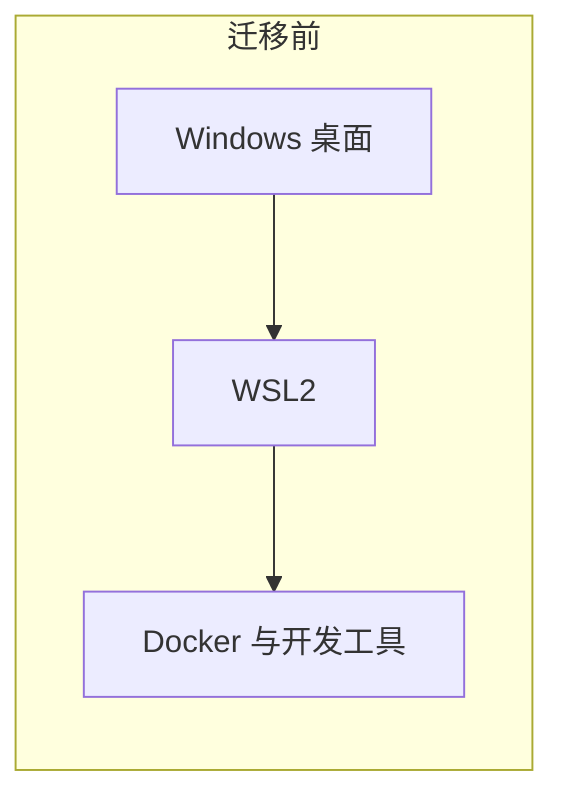
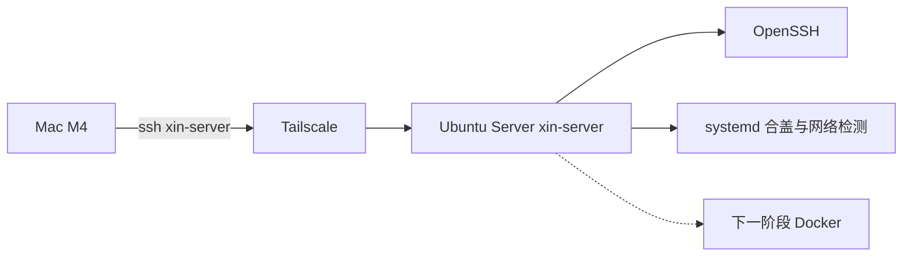
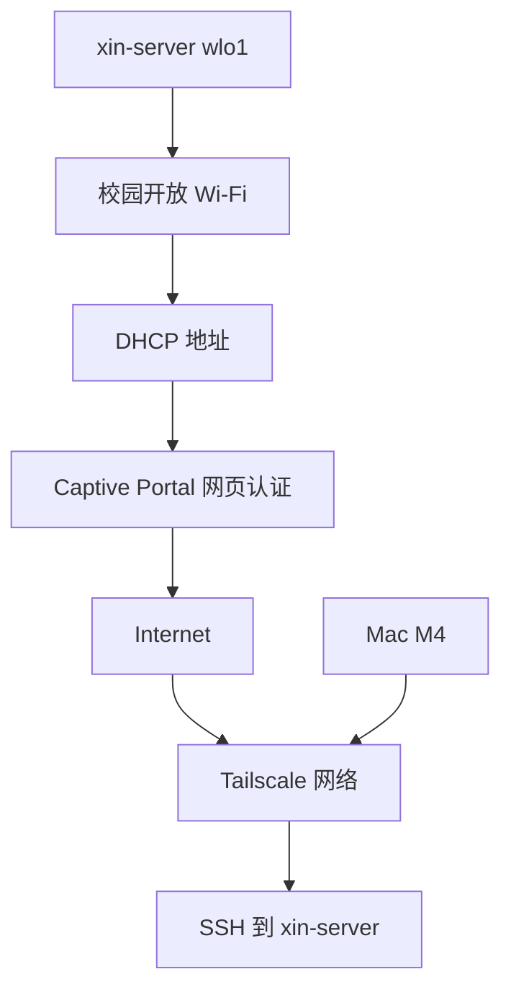

# 从碎屏 Windows 到无头 Linux 服务器

**From Broken Screen to Headless Server**

一台 2021 年的旧笔记本，如何从混乱的 Windows 开发环境，变成可以通过 Mac 随时远程管理的 Ubuntu 服务器。

记录从 2026 年 10 月 20 日的 Phase 1 开始。Phase 1 把这台坏屏笔记本收成可以用 SSH 管理的 Ubuntu Server。Phase 2 已经装上 Docker，并在 Mac 浏览器里打开了服务器上的第一张网页。Docker Hub 仍然连不上。

---

这台 2021 年的联想小新 Pro 16，曾经是一台普通的 Windows 开发机。WSL2、Docker、IDE、课程文件，以及各种试过又搁下的环境，把它变成了一座越来越难管理的软件仓库。磁盘使用情况也不理想。

更麻烦的是，它的屏幕坏了。平时靠一块 AOC 外接显示器才能看见桌面。

当我决定抹掉 Windows、让它成为一台 Linux 服务器时，我还不知道，第一个对手不是安装程序，而是那个根本看不见的启动菜单。外接显示器在 Windows 桌面里工作得很好，固件和早期启动画面却不肯出现。系统还没开始安装，我就先被一块坏掉的屏幕挡在了 BIOS 门口。

好在，一台服务器并不需要一块完好的屏幕。

它需要的是一套干净的系统、一条真的能上网的网络，以及一条从 Mac 通往它的 SSH 连接。坏屏幕最后变成了合上的盖子。Mac 上输入 `ssh xin-server`，打开的就是 `dev@xin-server`。

Docker 还在下一章。这一章把地基打完。

## 这个仓库是做什么的

把一台几乎不再使用 Windows 的旧笔记本，装成一台可以用 Mac 远程管理的 Ubuntu Server，并把已经发生的步骤、报错和取舍记下来，供以后的自己和遇到类似情况的人查阅。Phase 1 停在 Docker 之前。Phase 2 记录引擎、离线镜像和第一个网页。

文档同时是三种东西：一段迁移故事，一份可以对照命令的 Linux 记录，以及一个还会继续更新的工程仓库。没有发生过的操作不会写成已经完成。

## 为什么是原生 Linux，而不是 Windows + WSL2

当初有两条路。

| | 方案 A | 方案 B，也就是最后选的 |
| --- | --- | --- |
| 做法 | 重装干净的 Windows，再把一部分资源分给 WSL2 | 清除 Windows，安装原生 Ubuntu Server |
| 能做什么 | WSL2 里可以正常跑 Docker 和 Linux 开发工具 | 机器本身就是服务器 |
| 没选或选它的原因 | Windows 几乎不用，主机仍要负责休眠、更新和那块坏屏幕上的桌面 | 这台电脑要长期开着当服务器 |

WSL2 本身没有问题。它能跑 Docker，也能跑日常的 Linux 工具。这次换掉它，是因为使用场景变了：我要的是一台长期在线的服务器，而不是 Windows 桌面里的一个 Linux 环境。

原生 Linux 更合适，是因为这几件具体的事：

- 服务器的职责落在主机自己身上。合盖、开机、网络和 SSH 都由同一套 systemd 管理，不再先启动一整套 Windows，再在里面托管 WSL2。
- 这台机器几乎不再当 Windows 桌面用。继续维护一个很少打开的图形系统，只为了托住服务器，成本和收益不匹配。
- 内屏已经损坏。图形桌面依赖外接显示器；文本终端加上远程 SSH 之后，显示器可以离开。
- 原来的 Windows 环境已经很难收拾。与其在原地基上再隔一层，不如在备份之后使用整块 SSD。

WSL2 适合“我正在用 Windows，同时需要 Linux”。这台小新的新角色是“请一直开着，等 Mac 来连接”。

## 两台机器

| | 主力开发机 | 改造成的服务器 |
| --- | --- | --- |
| 机器 | Apple Mac，M4 | 联想小新 Pro 16，2021 款 |
| 内存 | 24GB 统一内存 | 16GB |
| 磁盘 | 512GB SSD | 1TB SSD |
| 显示 | 日常使用的 Mac 屏幕 | 内屏损坏，迁移前依赖 AOC 外接显示器 |
| 其他 | 写代码、编辑、发起 SSH | 4GB 显存；无线网卡 MediaTek MT7921 |
| 迁移后的系统 | macOS | Ubuntu Server 26.04.1 LTS，amd64 |
| 主机名 / 用户 | SSH 客户端 | 主机名 `xin-server`，用户 `dev` |
| 怎么找到对方 | Tailscale，配置别名 `xin-server` | 校园 Wi-Fi `wlo1`，再加上 Tailscale |

Mac 继续负责开发和编辑。小新不再负责桌面，改负责一直在线。

## 架构

迁移前，开发工具叠在 Windows 里面。WSL2 能工作，但服务器的生命周期仍被 Windows 宿主决定。

迁移后，Mac 不走校园网内网去找小新的局域网地址。两边各自上网，再在 Tailscale 里相遇。SSH 的权限仍由 Ubuntu 上的 `sshd` 决定。

校园网这边要分三层看：无线连上、DHCP 拿到地址、网页认证放行。三层都通过之后，这台服务器才能去联系 Tailscale。Mac 再从 tailnet 走回来。

图里的 Docker 节点是下一阶段。Phase 1 结束时，它还没有安装。这三张图保持当时的样子。Docker 跑起来之后的路径在下面的 Phase 2。

## 时间线

钟点没有逐条记下。下面是 2026-10-20 这次记录里，事情实际发生的顺序。

1. 重要文件备份完成。Windows 几乎不用，决定整机改成 Linux 服务器。
2. 在 Windows 上用 Rufus 4.15 把 Ubuntu Server 26.04.1 LTS 写进 32GB U 盘。
3. 坏屏让固件菜单在 USB-C 转接的外接显示器上不出现。换到笔记本原生 HDMI 之后，看到联想启动菜单和 Ubuntu GRUB。
4. 安装器使用整块 SSD。约 1GiB EFI，约 930GiB 的 ext4 根分区。不使用 LVM，不启用 LUKS。主机名 `xin-server`，用户 `dev`，安装 OpenSSH。
5. 第一次启动没有配好的网络，`network wait-online` 让开机等了一阵，最后进入 tty1，登录到 `dev@xin-server`。
6. 安装器留下的 Netplan `match` 配置被 networkd 拒绝。改成按接口名 `wlo1` 连接开放校园网。
7. DHCP 成功之后互联网仍不通。终端里完成校园网网页认证，随后 HTTPS 探测得到正常的 HTTP 200。
8. Mac 直接访问校园网 IP 的 SSH 超时。现象与无线客户端隔离一致，学校管理员没有确认。改用 Tailscale。
9. 两端加入同一个 tailnet。Mac 生成 Ed25519 密钥，最后可以用 `ssh xin-server` 登录。
10. 写入 logind 合盖配置。外接电源下合盖，Tailscale 上的 SSH 保持可用。
11. 校园网检测定时器运行，并记下 `Internet OK; no login required.`。认证自然过期后的自动重登还没有实测。
12. `apt upgrade` 约 152 个包，在 tmux 里完成。重启后内核为 `7.0.0-38-generic`，`ssh xin-server` 再次成功。

## 现在到哪了

Phase 1 完成的定义仍然有效：Mac 执行 `ssh xin-server`，进入的是升级并重启之后的 `dev@xin-server`，内核是 `7.0.0-38-generic`。合盖不断开这条会话。校园网检测定时器处于 active。

Phase 2 在此之上：Docker 服务为 `active (running)`，本地镜像和 Compose 已经跑通，Mac 浏览器通过 SSH 隧道打开了 hello-web。Docker Hub 的直接访问还没有恢复。

- [x] Windows 备份与系统替换
- [x] Ubuntu Server 安装
- [x] 无屏幕依赖的远程管理
- [x] 校园 Wi-Fi 与网页认证
- [x] Mac 远程 SSH
- [x] Tailscale 私有组网
- [x] SSH 密钥认证
- [x] 合盖不休眠
- [x] 自动校园网检测 Timer
- [x] 系统更新与重启验证
- [x] Docker Engine 安装
- [x] Docker Compose V2 与 Buildx
- [x] 离线镜像、Compose 测试和第一个网页
- [ ] 认证自然过期后的自动恢复完整实测
- [ ] Docker Hub 直接访问
- [ ] 数据库、API 等服务部署
- [ ] 监控、备份和告警

“检测 Timer 已完成”指的是定时器已启用、状态为 active、并且在网络正常时会退出。它还不等于“断网后一定能自己认证回来”。

## 十个坑

详细过程在对应文档里。这里只留一句原因和一句结果，方便以后先扫一眼。

| # | 遇到的事 | 结果 |
| --- | --- | --- |
| 1 | Windows 桌面能用外接显示器，UEFI 和早期启动画面不能 | 改用笔记本原生 HDMI 之后，启动菜单变得可见。见 [显示排查](docs/03-headless-display-troubleshooting.md) |
| 2 | 容易以为必须先在 Windows 里做系统重置 | 可以从 Ubuntu 安装介质直接启动，在安装过程中清除旧系统。备份要先做完。见 [安装](docs/02-ubuntu-installation.md) |
| 3 | 第一次开机停在 `network wait-online` | 安装时跳过了连不上的 Wi-Fi，系统在等一个还不存在的网络。最后仍进入了 tty1。见 [安装](docs/02-ubuntu-installation.md) |
| 4 | `netplan apply` 报 `networkd backend does not support wifi with match` | 删掉 `match` 和 `set-name`，按真实接口名 `wlo1` 重写。安装器里见过的名字是 `wlan0`。见 [校园网](docs/04-campus-network.md) |
| 5 | YAML 缩进不一致、冒号后缺少空格，nano 的文件名提示也搅局 | 改完再执行 `netplan generate`。它成功时通常没有任何输出。见 [校园网](docs/04-campus-network.md) |
| 6 | Wi-Fi 已拿到 DHCP 地址，curl 却收到一段 JavaScript 跳转 HTML | 这是 Captive Portal。连上开放网络，和通过网页认证，是两件事。curl 不会执行那段 JavaScript。见 [校园网](docs/04-campus-network.md) |
| 7 | SSH 已在 `0.0.0.0:22` 监听，Mac 访问校园网 IP 仍然 `Operation timed out` / `Host is down` | 路由里见过 `REJECT`。现象与客户端隔离高度一致，没有管理员的最终确认。后来改走 Tailscale。见 [远程访问](docs/05-remote-access.md) |
| 8 | Tailscale 两端都显示 Connected，仍要单独配置 SSH 密钥 | Tailscale 只负责送达。`authorized_keys` 才负责放行。私钥不进这个仓库。见 [远程访问](docs/05-remote-access.md) |
| 9 | 升级之后 `ssh.service` 变成 inactive 或 disabled | `ssh.socket` 是 active 且 enabled。这是 socket activation，SSH 当时仍然可用。见 [维护](docs/08-system-maintenance.md) |
| 10 | 定时器 active，日志也写了 Internet OK | 这只证明检测在网络正常时会跳过登录。认证过期后的自动恢复还没有完整实测。见 [自动认证](docs/07-auto-network-auth.md) |

合盖配置也值得单独记住：外接电源下的合盖测试通过了。这几行 logind 配置不能证明每一台笔记本都不会睡。见 [笔记本当服务器](docs/06-laptop-as-server.md)。

## Phase 2：Docker Hub 连不上？那就从零构建第一个容器

**Phase 2 — Docker Is Running, Even When Docker Hub Isn't**

我以为装上 Docker 就结束了。官方软件源在 `apt update` 时被对端重置，GPG 公钥却已经检查通过。换成 Ubuntu 官方源之后，引擎起来了：`docker.io` 29.1.3、Compose 2.40.3、Buildx 0.30.1。`docker` 服务是 `active (running)`，并且 enabled。

然后 `sudo docker run --rm hello-world` 没有等到 Hello。本地没有镜像，解析 `docker.io/library/hello-world:latest` 时 `i/o timeout`。`registry-1.docker.io` 的解析结果不稳定，HTTPS 也超时。现象让人怀疑 DNS 或出去的路径有问题。证据不够把具体机制写成结论，所以 Docker Hub 保持未解决。引擎在运行，仓库连不上。这两句同时成立。

于是不再等外部镜像。Ubuntu 的 `busybox-static` 放进 `FROM scratch`，`--pull=false` 构建，`--network none` 运行，终端打出 `Hello from Docker on xin-server!`。Compose 用 `pull_policy: never` 把同一张镜像跑完，退出码是 0。那次测试容器随后删掉了。

目录先定在 `/srv/docker`：`stacks`、`data`、`secrets`。引擎自己的数据仍在 `/var/lib/docker`。`data` 目录不是备份。

第一个一直开着的服务是 hello-web。BusyBox 的 `httpd` 只发布在服务器的 `127.0.0.1:8080`。Mac 上执行 `ssh -N -L 18080:127.0.0.1:8080 xin-server`，浏览器打开 `http://localhost:18080`，看见了 **Welcome to xin-server**。隧道关掉，浏览器这条路就断。容器还在。校园网上没有这个 8080。

详细命令在文档里，不堆在首页。

| 文档 | 这一段发生了什么 |
| --- | --- |
| [Docker 安装](docs/10-docker-installation.md) | 官方 APT 失败，Ubuntu 源安装成功 |
| [镜像仓库超时](docs/11-docker-registry-troubleshooting.md) | hello-world 超时，机制尚未证实 |
| [离线容器](docs/12-offline-container-build.md) | scratch 与静态 BusyBox |
| [Compose 测试](docs/13-docker-compose.md) | 本地编排、退出码 0、清理测试容器 |
| [目录规划](docs/14-docker-directory-layout.md) | `/srv/docker` 的权限和边界 |
| [第一个网页](docs/15-first-web-service.md) | hello-web 与 SSH 隧道 |
| [跨架构计划](docs/16-cross-architecture-plan.md) | ARM64 到 AMD64，尚未测试 |

示例在构建前要自己准备静态 BusyBox，仓库里没有那份二进制：

- [离线 Hello](examples/docker/offline-hello/README.md)
- [hello-web](examples/docker/hello-web/README.md)

## 文档

按迁移顺序读，就是上面的故事。按问题跳，用这张表。

| 文档 | 内容 |
| --- | --- |
| [为什么离开 Windows](docs/00-origin.md) | 两台电脑、两套方案，以及为什么选原生 Linux |
| [硬件与架构](docs/01-hardware-and-architecture.md) | 双机分工、三条架构图、流量经过哪些层 |
| [Ubuntu 安装](docs/02-ubuntu-installation.md) | Rufus、分区、OpenSSH、第一次启动 |
| [坏屏幕与启动菜单](docs/03-headless-display-troubleshooting.md) | F12、外接显示、旧启动项 |
| [校园网](docs/04-campus-network.md) | Netplan、`wlo1`、Captive Portal |
| [远程访问](docs/05-remote-access.md) | 直连失败、Tailscale、SSH 密钥、`ssh xin-server` |
| [笔记本当服务器](docs/06-laptop-as-server.md) | 合盖、logind、实际测试过的范围 |
| [自动检测与认证](docs/07-auto-network-auth.md) | 定时器设计、权限、还没实测的那一段 |
| [系统更新与重启](docs/08-system-maintenance.md) | apt、tmux、socket activation、新内核 |
| [踩坑总结](docs/09-lessons-learned.md) | Phase 1 结束时可以带走的判断 |
| [Docker 安装](docs/10-docker-installation.md) | 官方源失败，Ubuntu 源安装成功 |
| [镜像仓库超时](docs/11-docker-registry-troubleshooting.md) | Docker Hub 仍未打通 |
| [离线容器](docs/12-offline-container-build.md) | 本地 scratch 镜像 |
| [Compose 测试](docs/13-docker-compose.md) | V2 编排与测试容器清理 |
| [目录规划](docs/14-docker-directory-layout.md) | `/srv/docker` |
| [第一个网页](docs/15-first-web-service.md) | hello-web 与 Mac 浏览器 |
| [跨架构计划](docs/16-cross-architecture-plan.md) | 尚未测试的镜像传输 |
| [Roadmap](ROADMAP.md) | 已完成的 Phase 2，以及还没做的服务 |
| [安全说明](SECURITY.md) | 脱敏、Docker 端口和 docker 组 |

可抄走之前先替换占位符的示例：

- [Netplan 开放 Wi-Fi](examples/netplan/campus-open-wifi.yaml)
- [合盖 drop-in](examples/systemd/90-server-lid.conf)
- [网络检测 service](examples/systemd/network-check.service)
- [网络检测 timer](examples/systemd/network-check.timer)
- [认证检查脚本模板](examples/scripts/captive-portal-check.sh)，占位符未替换时会拒绝运行
- [离线 Hello 镜像](examples/docker/offline-hello/README.md)，构建前要准备静态 BusyBox
- [hello-web](examples/docker/hello-web/README.md)，端口只绑定在回环地址

## 安全

公开版本使用占位符：`<CAMPUS_WIFI_SSID>`、`<SERVER_TAILSCALE_IP>`、`<WIFI_MAC_ADDRESS>`、`<AUTH_ENDPOINT>`。

校园网账号、密码、真实内网地址、MAC、Tailscale 地址、SSH 私钥和带凭据的 URL 都不在仓库里。服务器上的凭据目录是 root-only，这种权限不能消除磁盘镜像和 HTTPS GET 查询日志的风险。Tailscale 设备在线也不会自动获得 shell。hello-web 只绑在 `127.0.0.1:8080`，Docker 的发布端口不能靠一句“以后再配 UFW”就算保护好了。

完整约束见 [SECURITY.md](SECURITY.md)。

## 下一步

Phase 2 已经把 Docker Engine、Compose、本地镜像和第一个网页做完。Docker Hub 的直接访问还没恢复。下一步是把 Linux AMD64 镜像从另一台机器送到 Ubuntu，这一步还没测试。数据库、API、备份和监控仍未开始。朋友 Mac 的访问曾经讨论过方案，设备共享和登录都还没有做。

认证自然过期后的自动恢复，仍是 Phase 1 里打开的验证项。

细节和不会提前打勾的清单见 [ROADMAP.md](ROADMAP.md)。

## 这个仓库会继续更新

Phase 1 的文档停在 Docker 安装之前，那些篇目不再改写成后来已经装了 Docker。Phase 2 用新的文档追加。以后每做完一段，就同样追加，而不是回去把计划改写成既成事实。命令、配置和报错以当时的记录为准。示例和叙述分开：叙述保留这台 `xin-server` 的真实路径，示例使用脱敏后的文件，BusyBox 二进制不进仓库。

有报错需要更正时，直接改对应文档并在提交说明里写清楚。密钥和口令仍然不进 Git。
