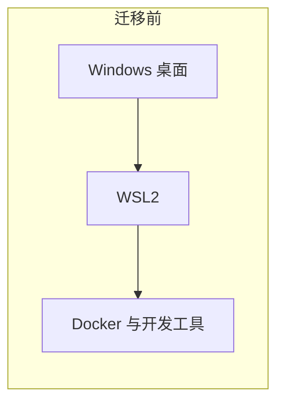
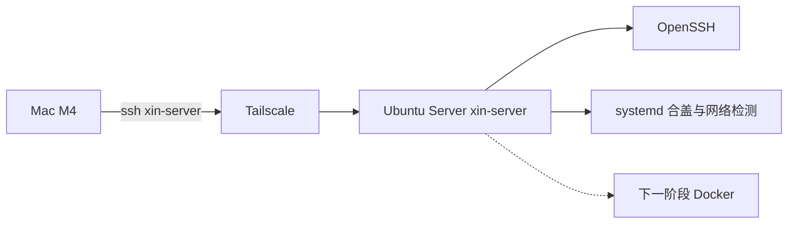
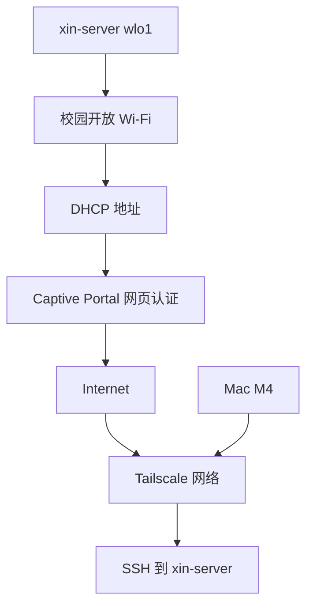

# 硬件与架构

> 记录日期：2026-10-20。阶段：Phase 1，Docker 安装之前。

返回 [项目首页](../README.md)。上一篇：[为什么离开 Windows](00-origin.md)。

## 分工

迁移完成之后，两台机器的职责不再重叠。

| | Mac | 小新 Pro 16 |
| --- | --- | --- |
| 角色 | 日常开发，远程管理 | 无头 Ubuntu Server |
| 年份 / 型号 | Apple Mac，M4 | 联想小新 Pro 16，2021 |
| 内存 | 24GB 统一内存 | 16GB |
| 磁盘 | 512GB SSD | 1TB 内置 SSD，安装时整盘使用 |
| 图形 | 使用 Mac 自己的屏幕 | 内屏损坏。迁移前用 AOC 外接显示器看见 Windows |
| 无线 | 加入校园网，并加入 Tailscale | MediaTek MT7921。安装界面里见过 `wlan0`，装完以后的接口名是 `wlo1` |
| 系统 | macOS | Ubuntu Server 26.04.1 LTS，amd64 |
| 名字 | SSH 配置里的客户端 | 主机名 `xin-server`，登录用户 `dev` |

4GB 显存留在硬件清单里，是为了以后真要碰显卡时记得有这块能力。Phase 1 没有安装专有显卡驱动，也没有把显卡用起来。

## 迁移前

Windows 桌面是宿主。WSL2 跑在里面，Docker 和其他开发工具再跑在那个环境里。这条链路当时能工作。它被换掉，是因为我不想再让服务器依附于一个很少使用、又依赖外接显示器的 Windows。

## 迁移后

Mac 是控制端。Ubuntu 是被控端。两边不依赖校园网把彼此的内网地址路由通。它们各自能够访问互联网之后，在 Tailscale 组建的网络里到达对方。SSH 仍由 Ubuntu 上的 OpenSSH 决定是否放行。

虚线的那一格是 Phase 1 结束时还没做的事。Phase 2 已经装上 Docker，当时的访问路径见 [第一个网页](15-first-web-service.md)。

## 从服务器到互联网，再回到 SSH

校园无线网络上的路径要拆开看，否则后面的故障会挤成一句“网不行”。

对应到后来真正发生的事：

1. Netplan 让 `wlo1` 关联开放 SSID，并向校园网要到地址。
2. 地址已经在手时，普通网站仍返回门户页面。网页认证通过之后，互联网才通。
3. 互联网通了，Mac 直接访问这台机器的校园网 IP 仍然失败。
4. 两端的 Tailscale 都在线之后，SSH 走 tailnet 成功。

第 3 步的失败原因，现象上与无线客户端隔离一致。学校网络管理员没有给出最终确认，所以架构图把“走 Tailscale”画成最终选择，不把“校园网禁止设备互访”画成已经证实的策略。细节在 [远程访问](05-remote-access.md)。

## 无头在这里是什么意思

无头指的是日常管理不依赖这块坏掉的内屏，也不依赖一直插着的外接显示器。

本地 tty1 在重启之后仍然会显示登录提示。那是物理控制台，它在就在，不在也不影响已经建立的 SSH。服务器的工作入口是 Mac 上的 `ssh xin-server`。

安装那一天是例外。固件菜单和安装器还没有网络、没有 SSH。那一段时间必须有一块能显示启动画面的屏幕。经过见 [坏屏幕与启动菜单](03-headless-display-troubleshooting.md)。

## 这张图里还没有的东西

防火墙的收口、多用户、容器、数据库、备份，在 Phase 1 结束时都还没做。上面的图停在那个时刻：校园网连通性、Tailscale、OpenSSH，以及两个 systemd 配置（合盖、认证检测）。

Phase 2 后来在本机回环地址上跑起一个 Web 容器，并用 SSH 隧道从 Mac 打开。那部分见 [第一个网页](15-first-web-service.md)。防火墙收口、数据库和备份仍然没做。

下一篇进入安装介质和磁盘：[Ubuntu 安装](02-ubuntu-installation.md)。
