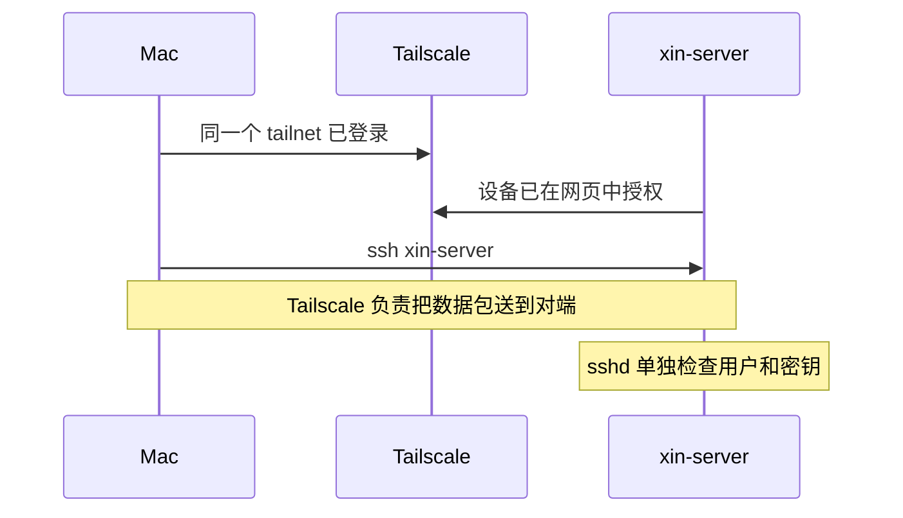

# 远程访问：直连失败、Tailscale 与 SSH 密钥

> 记录日期：2026-10-20。阶段：Phase 1，Docker 安装之前。
> 文档中的 Tailscale 地址一律写 `<SERVER_TAILSCALE_IP>`。

返回 [项目首页](../README.md)。上一篇：[校园网](04-campus-network.md)。

互联网已经从 Ubuntu 这一侧打通。Mac 也在校园 Wi-Fi 里。下一步看起来只是 SSH。这一步没有走通，Tailscale 是在这次失败之后才装的。

## SSH 服务本身是好的

安装器里勾过 OpenSSH。在服务器上检查：

```bash
systemctl is-active ssh
```

返回 `active`。端口监听是：

```text
0.0.0.0:22
```

`0.0.0.0` 表示 sshd 在所有 IPv4 接口上接受连接，包括校园网那块 `wlo1`。服务状态和监听地址都正常。后面的失败不在 sshd 没启动。

这次的 `systemctl is-active ssh` 是升级之前的观察。升级之后同一组单元的表现变了，`ssh.service` 可以是 inactive，而真正在听端口的是 `ssh.socket`。那是后话，记在 [系统更新与重启](08-system-maintenance.md)。读日志时要看它属于哪一次检查。

## Mac 直接访问校园网 IP

Mac 去连 Ubuntu 的校园网地址时，SSH 给出：

- `Operation timed out`
- `Host is down`

当时还关掉 Mac 上另一个 VPN，再测了一次。直连没有因此变成一条可用的管理通道。Mac 的路由检查里出现过 `REJECT`。

这些现象和校园无线网络的客户端隔离高度一致：两台设备都能访问互联网，却不能互相访问对方的内网地址。隔离会让同一套 Wi-Fi 上的客户端彼此不可达，路由或防火墙直接拒绝这段流量。

这个判断停在“高度一致”。学校网络管理员没有确认这就是当时的策略，所以这里不写成已经证实的 AP Isolation，也不写成“校园网禁止 22 端口”这种更窄的结论。能确定的是：在 sshd 正常监听的前提下，Mac 走校园网 IP 到不了这台机器。继续耗在这条路径上，管理通道建立不起来。

最终的选择是绕开这段不可达的内网，用 Tailscale 建一条独立的加密通道。

## Tailscale 把两台机器放进同一个网络

Ubuntu 上安装了 Tailscale 客户端。在网页里完成这台设备的授权之后，它得到一个 Tailscale IPv4 地址。Mac 也安装 Tailscale，用同一个私有网络账号加入。两边最后都显示 Connected，并且在线。

Mac 改为连接这个地址：

```bash
ssh dev@<SERVER_TAILSCALE_IP>
```

这条路是通的。后面的密钥和别名都建立在这个地址上。

官方客户端的安装方式以 Tailscale 文档为准。这次记录下来的结果是：客户端已安装、浏览器授权已完成、地址已分配、两端状态为 Connected。没有记录额外的路由公告或 Exit Node。那些功能这次没有使用。

### 它在技术上是什么

Tailscale 基于 WireGuard。每台设备有自己的密钥，设备之间的数据用 WireGuard 加密。Tailscale 在此之上做登录、设备列表和打洞协调。

Tailnet 是这个账号下的私有网络。加入同一个 tailnet 的设备，使用 Tailscale 分配的地址互相访问，而不使用校园网 DHCP 发的那份地址。两台机器可以在不同的物理网络里：只要各自能到达 Tailscale 的协调服务，它们就有机会互相发现。校园网这一侧必须先通过网页认证，协调流量才出得去。所以顺序是先门户，后 Tailscale，不能反过来指望 Tailscale 去完成校园网登录。

直接的 UDP 打洞有时会被 NAT 或防火墙挡住。那种情况下，流量可以改走 Tailscale 的加密中继。中继仍然是密文转发，协调服务器不因此获得 shell。这次连接是直连还是中继，当时没有记录，文档不猜测。

使用 Tailscale 和校园网，都要遵守学校的网络规定。加密通道不是绕过使用政策的理由。

### 设备授权和 SSH 授权是两把锁

浏览器里同意一台设备加入 tailnet，只说明这台设备可以出现在这个私有网络里。

Linux 的 shell 还要第二把锁。`sshd` 检查用户名，以及密码或 `~/.ssh/authorized_keys`。Tailscale 显示 Connected 的人，可以是一台还没有 Ubuntu 账号的机器。网络可达，不会自动创建 Linux 用户，也不会自动写入公钥。



## 从密码登录到密钥

第一条 SSH 用的是安装时允许的密码，用户是 `dev`。密码登录成功之后，才在 Mac 上生成密钥。

```bash
ssh-keygen -t ed25519 -f ~/.ssh/id_ed25519_xinserver
```

`ssh-keygen` 会询问 passphrase。这次设了独立的 passphrase。生成结果是一对文件：

| 文件 | 留在哪里 | 作用 |
| --- | --- | --- |
| `~/.ssh/id_ed25519_xinserver` | 只留在这台 Mac | 私钥。证明持有人。不进入 Git |
| `~/.ssh/id_ed25519_xinserver.pub` | 公钥副本放到服务器 | 给 sshd 对照。它不是秘密，但仓库里仍然不收录这份公钥，避免无谓的设备标识 |

私钥像钥匙。公钥像挂在服务器上的锁芯。锁芯可以装到要登录的机器上，钥匙不复制进仓库、Issue 或聊天记录。

passphrase 用来加密 Mac 本地的私钥文件。Ubuntu 用户 `dev` 的登录密码是另一回事。知道其中一个，不能推出另一个。

公钥追加到服务器上的：

```text
~/.ssh/authorized_keys
```

追加，保留文件里已经存在的条目。用单次 `>` 覆盖会把原有授权一起擦掉。SSH 要求这个目录是 `700`、这个文件是 `600`，并且属主是 `dev`。这次没有遇到权限导致的拒绝，这里记下的是 sshd 的要求，方便以后重做时一次做对。

然后在 Mac 上指定这把钥匙测试：

```bash
ssh -i ~/.ssh/id_ed25519_xinserver dev@<SERVER_TAILSCALE_IP>
```

测试通过之后，才把快捷方式写进 Mac 的 `~/.ssh/config`：

```sshconfig
Host xin-server
  HostName <SERVER_TAILSCALE_IP>
  User dev
  IdentityFile ~/.ssh/id_ed25519_xinserver
```

之后这一条就够了：

```bash
ssh xin-server
```

它打开的提示符仍然是 `dev@xin-server`。别名只是客户端配置，不改变服务器上的用户名。

第一次连上一台新主机时，SSH 会询问是否信任对方的 host key，同意之后写入本机 `known_hosts`。那一步是在确认“对面这台机器是谁”。上面的 Ed25519 密钥是在确认“我是不是 `dev` 的钥匙持有者”。两次确认都通过，会话才成立。这个仓库不记录 host key 指纹。

密钥登录已经验证。关闭密码登录是下一步才应该考虑的加固：要先确认钥匙能进门，再拆掉密码这把备用钥匙。这次迁移没有把“密码登录已关闭”记成完成项。当前文档保持这个事实。

## 讨论过、还没做的朋友访问

曾经讨论过怎样让一台完全独立、没有加入这个 tailnet 的朋友 Mac 访问服务器。谈过的做法是：

- 用 Tailscale 共享指定设备，朋友用自己的 Tailscale 账号接受。
- 如果需要 SSH，在 Ubuntu 上另建 Linux 用户，只放入朋友自己的公钥。
- 不把 `dev` 的口令、Mac 上的 SSH 私钥、Tailscale 登录或邀请令牌交出去。

邀请没有发出，用户没有创建，对方没有登录。这是未来计划，见 [Roadmap](../ROADMAP.md)。

管理通道稳定之后，下一件物理上的事是：这块坏屏笔记本要合盖运行。[笔记本当服务器](06-laptop-as-server.md)。
