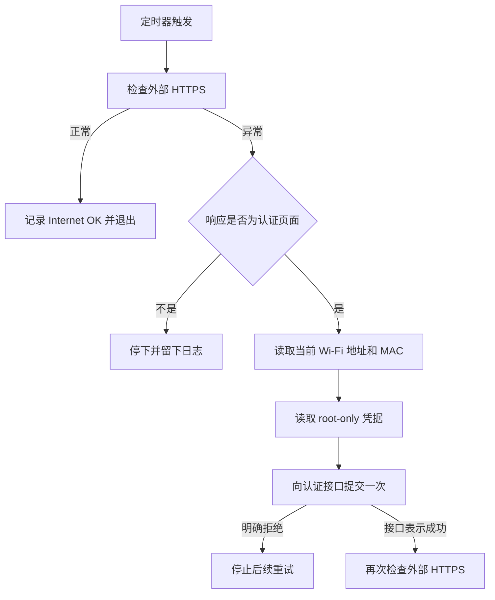

# 自动检测与校园网认证

> 记录日期：2026-10-20。阶段：Phase 1，Docker 安装之前。
> 凭据文件不在这个仓库里。示例单元使用通用文件名。

返回 [项目首页](../README.md)。上一篇：[笔记本当服务器](06-laptop-as-server.md)。

校园网的网页认证会过期。机器要长期开着，不能每次过期都找一块显示器、再找一次 curl。所以加了一段定时检测：网络是好的就什么也不做，只有确认自己正站在门户前面时才尝试登录。

**验证边界先写在这里。** 定时器已经启用，状态是 active。journal 里出现过 `Internet OK; no login required.`。校园网认证自然过期之后，脚本发现门户、提交凭据、再确认互联网恢复的完整过程，还没有经过实测。检测在运行，自动恢复还不是已验证能力。

## 服务器上的真实路径

| 用途 | 路径 | 权限 |
| --- | --- | --- |
| 凭据目录 | `/etc/bjtu-auth/` | `700`，root |
| 凭据文件 | 该目录下的用户名和密码文件 | `600`，root |
| 检查脚本 | `/usr/local/sbin/bjtu-autologin-check.sh` | 留在服务器上，不进 Git |
| 服务 | `bjtu-autologin.service` | 由定时器触发的一次性任务 |
| 定时器 | `bjtu-autologin.timer` | enabled，active |

目录名带着这次校园网的缩写，因为脚本是按这所学校当时的门户写的。它不是通用登录器。别的网络要换探测方式和认证接口，还要先确认使用政策允许自动登录。

仓库里的对应示例改用通用名字，避免把一份半成品客户端和真实路径混在一起：

- [`examples/systemd/network-check.service`](../examples/systemd/network-check.service)
- [`examples/systemd/network-check.timer`](../examples/systemd/network-check.timer)
- [`examples/scripts/captive-portal-check.sh`](../examples/scripts/captive-portal-check.sh)

脚本模板在占位符还在时会直接退出，不会访问网络，也不会读取密码。

## 设计成九步，是为了少登录

每次唤醒都提交密码，会把 GET 日志里的凭据复制很多遍，也会在密码错误时不停重试。实际脚本按这个顺序做决定：

1. 检查外部 HTTPS 是否连通。
2. 网络正常就退出，不重复登录。正常时的日志是 `Internet OK; no login required.`
3. 网络异常时，再看响应是不是校园网认证页面。
4. 只有检测到认证页面，才尝试登录。
5. 登录前读取当前 Wi-Fi 的 IP 和 MAC。这是运行时事实，不写死在文件里。
6. 凭据只从 root-only 文件读取。
7. 解析认证接口的成功或失败。这次见过的成功形态类似 `{"result":1,"msg":"Portal..."}`。
8. 遇到明确的认证拒绝，就停下，不再重试。
9. 接口表示成功之后，再做一次外部 HTTPS 检查，确认互联网真的回来了。



第 3 步把“网线式的故障”和“站在门户门口”分开。DNS 坏了、无线掉了、探测站点自己故障了，都不应该触发一次登录。

第 8 步是刹车。认证被明确拒绝时继续重试，只会把同一组错误凭据反复送给学校的服务器。

第 9 步对应一个已经踩过的现象：认证接口返回成功，和浏览器能打开网页，需要分开确认。HTTP 200 也要看正文。门户页同样可能带着 200 返回。

## 权限解决什么，不解决什么

`700` 的目录和 `600` 的文件，让普通用户读不到凭据。systemd 服务默认以 root 运行，所以读得到。

这些权限阻止不了：

- 拿到 root 的人读取文件
- 磁盘镜像和离线备份绕过文件权限
- shell history、`journalctl`、`curl -v` 把 URL 再记一份
- 校园网服务器记录 HTTPS GET 的查询字符串

现有登录方式就是 GET。这一点在 [校园网](04-campus-network.md) 里已经遇到。定时任务如果打印自己的请求，会把这个局限再放大一次。脚本不应该回显 URL，也不应该把密码放进单元文件的 `Environment=`。

完整的风险说明在 [SECURITY.md](../SECURITY.md)。

## 定时器

服务器上的单元名是 `bjtu-autologin.timer`。和示例文件一样，它使用：

```ini
[Timer]
OnBootSec=2min
OnUnitActiveSec=10min
AccuracySec=1min

[Install]
WantedBy=timers.target
```

- `OnBootSec=2min`：启动两分钟后再跑第一次，给无线关联和 DHCP 留时间。
- `OnUnitActiveSec=10min`：从这次开始算，10 分钟后跑下一次。它不是整点 cron。
- `AccuracySec=1min`：systemd 可以把这次唤醒推迟最多一分钟，用来合并定时器。它不是秒级监控。
- `WantedBy=timers.target`：`enable` 之后，定时器跟随系统的定时器目标启动。

启用的是 timer，不是那个一次性的 service。service 由 timer 拉起。

记录中的检查结果：

```text
systemctl is-enabled bjtu-autologin.timer
enabled

systemctl is-active bjtu-autologin.timer
active
```

journal 里出现过：

```text
Internet OK; no login required.
```

这三行证明的是：定时器已安装、正在计时，并且至少有一次探测认为互联网可用，于是没有登录。它们不证明第 4 步到第 9 步在一次真实过期里跑通了。

那次完整实测还没有发生。在它发生并被记下来之前，README 里“认证自然过期后的自动恢复”保持未勾选。

部署任何自动登录之前，先核对学校网络政策。政策不允许，就停在检测设计，不把凭据放进定时任务。

网络能自己报“目前是通的”之后，剩下的是把系统更新做完，并确认重启后这条远程路还在：[系统更新与重启](08-system-maintenance.md)。
