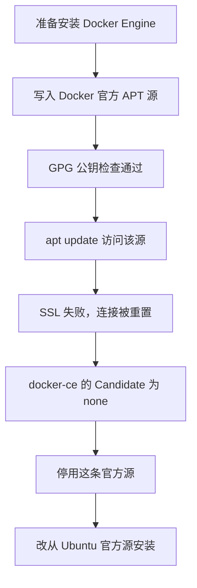

# Docker 安装：官方源连不上，Ubuntu 源装上了

> Phase 2。Docker Engine 已经安装并在运行。
> 已核对版本：docker.io 29.1.3，Compose 2.40.3，Buildx 0.30.1。

返回 [项目首页](../README.md)。上一篇是 Phase 1 的 [踩坑总结](09-lessons-learned.md)。

Docker 还没来得及启动，第一个拦路虎却是 Docker 自己的下载服务器。

Phase 1 结束时，Mac 已经可以用 `ssh xin-server` 进入这台无头 Ubuntu。接下来要的是 Docker Engine、Compose，以及一个真的能从浏览器打开的网页。安装引擎是第一步。我先走了 Docker 官方的 APT 仓库。公钥下来了，软件包索引没有下来。

## 官方源做到了哪一步

顺序是这五步：

1. 安装 `ca-certificates` 和 `curl`。
2. 创建 `/etc/apt/keyrings`。
3. 下载 Docker 官方 GPG 公钥。
4. 创建 `/etc/apt/sources.list.d/docker.sources`。
5. 执行 `apt update`。

公钥这一步的检查结果是：

```text
Docker GPG key OK
```

然后 `apt update` 访问这条新源时失败，报错里有：

```text
SSL connection failed
Connection reset by peer
```

接着查即将安装的包：

```bash
apt-cache policy docker-ce
```

结果是：

```text
Candidate: (none)
```

后来用 curl 再访问 Docker 官方仓库，同样是 `Connection reset by peer`。软件源索引没有进到本机的 APT 缓存里。

## 这几句话各自成立

GPG 公钥下载成功，只说明那一个文件当时能取下来，并且检查通过了。APT 还要再去取仓库的 `InRelease` 和包索引，并用这把公钥验证索引。索引那一步被对端重置了。钥匙在手，货架没打开。

`apt update` 可以一部分仓库成功、另一部分失败。Ubuntu 自己的软件源和刚加进去的 Docker 源是两条通道。一条报 `Connection reset by peer`，不能从另一条的成功推出“所有索引都是新的”。

`Candidate: (none)` 的意思很具体：以当前这台机器上的包索引，`docker-ce` 没有可安装的候选版本。它不是 Docker 守护进程崩溃，也不是容器运行时的报错。此时引擎还没装上，守护进程还不存在。

`docker-ce` 是 Docker 官方仓库里的包名。这次失败发生在索引获取，所以官方仓库里的候选版本没有出现在本地缓存中。后面改用的 Ubuntu 包名是 `docker.io`，不是 `docker-ce`。

校园网里出现连接重置，只能说明这条 TCP 连接没有完成。没有管理员的说明，也没有一份把重置来源定位到某一台设备的证据。文档不写“校园网管理员屏蔽了 Docker”。能写下来的是：官方 APT 源在这台服务器上当时不可用。



## 换成 Ubuntu 官方源

Ubuntu 26.04 的官方软件源里已经有需要的包。官方 Docker 源停用之后，安装不再去撞那条连不上的地址。停用的是源配置，不是已经下载的那把公钥本身有什么后续用途。然后执行：

```bash
sudo apt install -y docker.io docker-compose-v2 docker-buildx
```

这三个包对应的已核对版本：

| 组件 | 包名 | 已核对版本 |
| --- | --- | --- |
| Docker Engine | `docker.io` | 29.1.3 |
| Docker Compose V2 | `docker-compose-v2` | 2.40.3 |
| Docker Buildx | `docker-buildx` | 0.30.1 |

发行版修订号没有单独记进仓库。上表是这次核对到的版本号。

安装之后：

```bash
sudo systemctl status docker --no-pager
```

服务状态是 `active (running)`，并且已经 enabled。开机后它会自己起来。

三条版本命令都成功了：

```bash
docker --version
docker compose version
docker buildx version
```

到这里，Docker 的安装已经完成。后面的 `hello-world` 失败是镜像仓库的问题，不是这一步没装上。

## Engine 和 Desktop 不是同一个产品

服务器上装的是 Docker Engine：一个由 systemd 管理的 `dockerd`，加上命令行。没有图形界面，也不需要。

Docker Desktop 是装在开发机上的桌面产品，Mac 和 Windows 上常见。它自己带引擎，经常跑在虚拟机里。这台小新不需要那层桌面。Mac 在 Phase 2 里仍然是 SSH 客户端和浏览器，不是 Docker 的宿主机。Mac 上有没有本地引擎，这次没有作为安装步骤去记录。

Ubuntu 官方源是合理的备用渠道，因为软件包由发行版归档提供，安装不依赖 `download.docker.com` 上的那条 APT 索引。版本可能和 Docker 公司仓库不是同一天发布。这次拿到的 29.1.3 已经够完成构建、运行和 Compose。官方源仍然是上游的发布渠道。这台机器当时连不上它，所以没有继续等。

## Compose V2 的命令中间有空格

装上的是 `docker-compose-v2`。调用方式是：

```bash
docker compose version
```

中间是空格。这是 CLI 插件。早期的独立程序把连字符写进命令名，叫 `docker-compose`。这次测试和后面的网页部署用的都是带空格的 V2。文档里的命令保持这个写法。

## 为什么还在用 sudo docker

运行容器、构建镜像、执行 Compose，这次用的是 `sudo docker`。查看版本不一定要碰守护进程套接字，所以上面的三条 version 命令按当时的写法记录。

`docker` 用户组可以访问 `/var/run/docker.sock`。谁能跟这个套接字说话，谁就可以创建容器、挂载主机目录、在容器里以 root 运行。这和拥有 root 是同一量级的权限。所以这个组不随便加人。当前管理方式就是：需要引擎时使用 `sudo`。没有把 `dev` 写进 `docker` 组作为已完成步骤。

同一个套接字也不能暴露到校园网上。不要把 Docker API 监听改成 `0.0.0.0:2375` 这类网络端口，也不要把套接字转发出去。Phase 2 没有这样做。引擎只在本机使用。

## 这一章的结果

- Docker Engine 已安装，服务 `active (running)` 且 enabled。
- Compose V2 和 Buildx 已安装，版本命令成功。
- Docker 官方 APT 源在这台机器上没有成为可用的安装渠道。
- 引擎能启动，还不等于 Docker Hub 能拉镜像。下一篇就是这件事：[镜像仓库超时](11-docker-registry-troubleshooting.md)。
