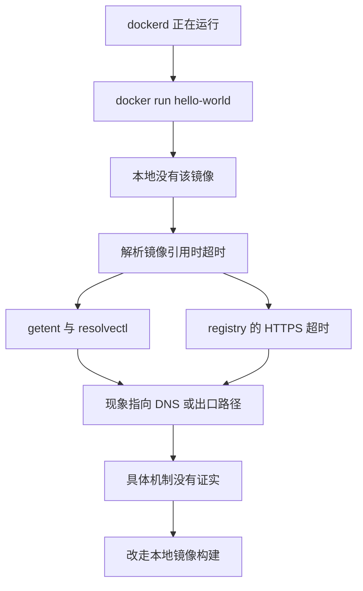

# Docker Hub：引擎在跑，镜像下不来

> Phase 2。Docker 服务已经 `active (running)`。Docker Hub 的直接访问没有修好。
> 这一篇不把 DNS 污染或校园网屏蔽写成已证实的结论。

返回 [项目首页](../README.md)。上一篇：[Docker 安装](10-docker-installation.md)。

Docker 已经安装成功，守护进程也启动了。可当我终于输入 `docker run hello-world`，迎接我的却不是 Hello，而是一场漫长的网络超时。

## 第一次运行失败

命令是：

```bash
sudo docker run --rm hello-world
```

本地没有这个镜像，于是引擎去仓库找。输出里先后出现：

```text
Unable to find image 'hello-world:latest' locally
failed to resolve reference docker.io/library/hello-world:latest
i/o timeout
```

`--rm` 表示容器退出后删掉。容器还没创建出来，所以这条参数没有机会起作用。失败点在“解析并下载 `docker.io/library/hello-world:latest`”。

守护进程已经在运行。它接到了命令，发现本地没有镜像，然后去连接注册表。超时发生在这一段外出访问，不是 `dockerd` 没启动。

## 接着查的三件事

```bash
getent ahostsv4 registry-1.docker.io
resolvectl query registry-1.docker.io
curl -4 -I https://registry-1.docker.io/v2/
```

域名能查出地址，但结果不稳定，而且其中一部分地址和这项服务预期所在的网络对不上。对 `https://registry-1.docker.io/v2/` 的 IPv4 HTTPS 请求超时，没有拿到注册表该返回的响应头。

当时还看了校园网正在使用的 DNS，并试了一次 Google 的 DNS-over-HTTPS。那次查询也超时。

这些命令的原始地址列表不放进仓库。不稳定的解析结果如果抄出来，会变成一份过期的、而且可能是错误的地址表。

## 能下的判断，和不能下的判断

下面几句是分开的：

- Docker 守护进程正常，不等于 Docker Hub 可访问。服务状态看的是本机进程。拉镜像看的是出去的网络。
- `getent` 返回了地址，不等于这些地址是对的。解析成功只表示 DNS 回答了问题。回答可以是不稳定的，也可以指向并不是这个服务的网络。
- HTTPS 超时可以由好几件事造成：解析到了走不通的地址、路由到不了、连接被中途丢掉、对端没有在预期的时间内响应。超时本身不指名是哪一种。
- 官方 APT 源的 `Connection reset by peer` 和这里的 `i/o timeout` 是两次观察。它们都发生在访问 Docker 公司的网络服务时，但是主机、阶段和报错不同。不能合并成同一种已证实的机制。
- 这次高度怀疑 DNS，或者校园网出去的访问路径有异常。怀疑来自上面那些现象。
- 没有足够证据证明具体的干扰方式。不写“已经证实是 DNS 污染”，也不写“校园网屏蔽了 Docker Hub”。



Google 的 DNS-over-HTTPS 也超时，说明“换一个解析渠道再问一次”这次没有问成。它不能用来证明校园 DNS 改写了答案，因为那条对照查询自己没有返回结果。对照实验没有做成。

## 这一章结束时还留着的问题

Docker Hub 的直接访问仍然没有解决。后面的离线镜像、Compose 测试和网页，都是在不拉取 Hub 镜像的前提下做的。它们证明本机能构建和运行容器，不证明 `hello-world` 现在可以拉下来。

下一篇记录绕开注册表的那次构建：[离线容器](12-offline-container-build.md)。
