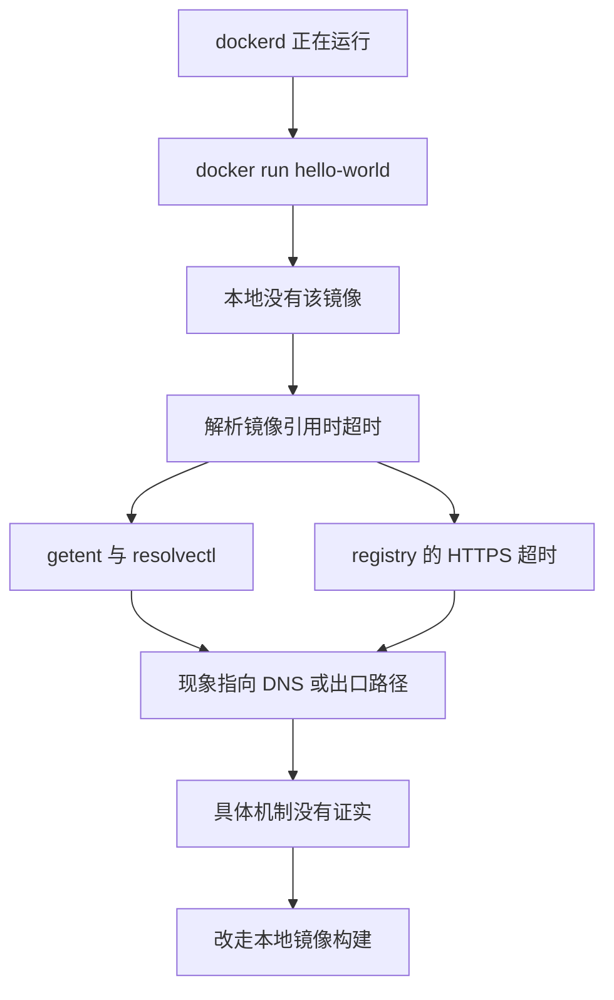
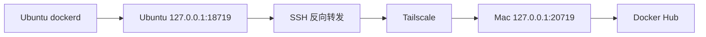

# Docker Hub：引擎在跑，镜像下不来

> Phase 2。Docker 服务已经 `active (running)`。Docker Hub 的直接访问没有修好。
> 这一篇不把 DNS 污染或校园网屏蔽写成已证实的结论。

返回 [项目首页](../README.md)。上一篇：[Docker 安装](10-docker-installation.md)。

Docker 已经安装成功，守护进程也启动了。可当我终于输入 `docker run hello-world`，迎接我的却不是 Hello，而是一场漫长的网络超时。

## 第一次运行失败

命令是：

```bash
sudo docker run --rm hello-world
```

本地没有这个镜像，于是引擎去仓库找。输出里先后出现：

```text
Unable to find image 'hello-world:latest' locally
failed to resolve reference docker.io/library/hello-world:latest
i/o timeout
```

`--rm` 表示容器退出后删掉。容器还没创建出来，所以这条参数没有机会起作用。失败点在“解析并下载 `docker.io/library/hello-world:latest`”。

守护进程已经在运行。它接到了命令，发现本地没有镜像，然后去连接注册表。超时发生在这一段外出访问，不是 `dockerd` 没启动。

## 接着查的三件事

```bash
getent ahostsv4 registry-1.docker.io
resolvectl query registry-1.docker.io
curl -4 -I https://registry-1.docker.io/v2/
```

域名能查出地址，但结果不稳定，而且其中一部分地址和这项服务预期所在的网络对不上。对 `https://registry-1.docker.io/v2/` 的 IPv4 HTTPS 请求超时，没有拿到注册表该返回的响应头。

当时还看了校园网正在使用的 DNS，并试了一次 Google 的 DNS-over-HTTPS。那次查询也超时。

这些命令的原始地址列表不放进仓库。不稳定的解析结果如果抄出来，会变成一份过期的、而且可能是错误的地址表。

## 能下的判断，和不能下的判断

下面几句是分开的：

- Docker 守护进程正常，不等于 Docker Hub 可访问。服务状态看的是本机进程。拉镜像看的是出去的网络。
- `getent` 返回了地址，不等于这些地址是对的。解析成功只表示 DNS 回答了问题。回答可以是不稳定的，也可以指向并不是这个服务的网络。
- HTTPS 超时可以由好几件事造成：解析到了走不通的地址、路由到不了、连接被中途丢掉、对端没有在预期的时间内响应。超时本身不指名是哪一种。
- 官方 APT 源的 `Connection reset by peer` 和这里的 `i/o timeout` 是两次观察。它们都发生在访问 Docker 公司的网络服务时，但是主机、阶段和报错不同。不能合并成同一种已证实的机制。
- 这次高度怀疑 DNS，或者校园网出去的访问路径有异常。怀疑来自上面那些现象。
- 没有足够证据证明具体的干扰方式。不写“已经证实是 DNS 污染”，也不写“校园网屏蔽了 Docker Hub”。



Google 的 DNS-over-HTTPS 也超时，说明“换一个解析渠道再问一次”这次没有问成。它不能用来证明校园 DNS 改写了答案，因为那条对照查询自己没有返回结果。对照实验没有做成。

## 这一章结束时还留着的问题

Docker Hub 的直接访问仍然没有解决。后面的离线镜像、Compose 测试和网页，都是在不拉取 Hub 镜像的前提下做的。它们证明本机能构建和运行容器，不证明 `hello-world` 现在可以从 Hub 直连拉下来。

按时间往下读，下一篇是绕开注册表的那次构建：[离线容器](12-offline-container-build.md)。

第一张网页跑起来之后，直连问题又查了一轮。下面是后来的记录，不是把前面的超时改写成已经修好。

## 指定 IP 之后，连接仍被重置

校园 DNS 多次返回过归属异常的 Docker Registry 地址。后来的 DNS-over-HTTPS 查询里也出现过可疑结果。这些地址没有抄进仓库。一份当时看起来不对的地址，过几天既不能当证据，也不能当修复。

接着用 curl 的 `--resolve` 把域名钉在选定的地址上再访问。HTTPS 还是被重置。所以这次不能说“换成正确的 DNS 答案就会通”。解析可疑，和指定地址后仍然失败，是两件并列的观察。

仍然不能确定全部原因是 DNS、校园出口策略、TLS 路径，还是目标地址自己在变。不把这写成已经证实的 DNS 污染，也不写成校园网的某一种主动封锁。

## Mac 上谁能连上 Hub

Mac 的 Docker Desktop 可以拉取 `linux/amd64` 镜像。同一台 Mac 的终端如果直接 curl Docker Registry，请求超时。

Desktop 使用的是 macOS 系统代理，代理监听在 Mac 自己的回环地址上。Desktop 内部还能看到 `http.docker.internal:3128`。那是它自己环境里的名字，Ubuntu 上没有这个地址。把它写进服务器的 Docker 配置，不会变成一条可用的代理。

在 Mac 上让 curl 走系统代理访问 `https://registry-1.docker.io/v2/`，响应是两层：

```text
HTTP/1.1 200 Connection established
HTTP/2 401
```

第一行是 HTTP 代理把 TLS 隧道建好了。第二行是 Registry 的 `/v2/` 在要求认证。未登录时拿到 401，表示服务有响应，不是这次要消除的超时。

## 反向隧道只是把 Mac 的出口借给 Ubuntu

测试时在 Mac 上保持这条命令。端口是这次临时选的，不是通用默认值：

```bash
ssh -N -T -o ExitOnForwardFailure=yes \
  -R 127.0.0.1:18719:127.0.0.1:20719 \
  xin-server
```

Ubuntu 的 `127.0.0.1:18719` 经 SSH 和 Tailscale 到达 Mac 的 `127.0.0.1:20719`，再进入 Mac 上的那份代理。从 Ubuntu 用这个本地端口访问 Registry，同样收到 HTTP 401。

然后给 Docker 写了一份临时 systemd drop-in，把 `HTTP_PROXY` 和 `HTTPS_PROXY` 指到 `http://127.0.0.1:18719`。`systemctl daemon-reload` 只让 systemd 重新读单元。环境变量要进入已经在跑的 `dockerd`，还重启了一次 Docker。

重启之后，在 Ubuntu 上执行：

```bash
sudo docker pull --platform linux/amd64 nginx:stable-alpine
```

各层都下载完成。用这张镜像起了测试容器，Ubuntu 本地的 `http://127.0.0.1:8081` 返回 HTTP 200。hello-web 的 8080 没有被这个测试换掉。

这条 `docker pull` 是在服务器上敲的。数据包的出口仍是 Mac。Mac 上的 SSH 或系统代理一停，这条路就断。它是临时通道，不是 Ubuntu 自己连上了 Docker Hub。验证下一条独立路径之前，drop-in 已改名为 `.disabled`，再次 `daemon-reload` 并重启 Docker。检查输出是 `No Docker proxy configured`。



## 不走代理时，另外两个 Registry 的入口

代理确认关掉之后，在 Ubuntu 上直接查入口：

```bash
curl -4 --noproxy '*' -I https://ghcr.io/v2/
curl -4 --noproxy '*' -I https://public.ecr.aws/v2/
```

`--noproxy '*'` 用来避免环境变量里还留着代理。GHCR 返回 `HTTP/2 405`，说明对方有 HTTP 响应，但没有接着做镜像拉取。ECR 返回 `HTTP/2 401`，和上面的 Registry 认证响应是同一类信号。

随后不使用代理，从 AWS Public ECR 拉下了 `public.ecr.aws/docker/library/nginx:latest`，架构是 `linux/amd64`，`nginx -v` 输出 `nginx/1.31.7`。这是服务器自己的下载。Docker Hub 直连仍未恢复。三条路的差别和限制写在 [镜像获取策略](17-registry-access-strategy.md)。Mac 把镜像打成文件再传过来的那次验证写在 [跨架构传输](16-cross-architecture-plan.md)。
