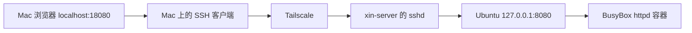

# 第一个网页：只绑在本机，Mac 用 SSH 隧道打开

> Phase 2 的完成点。Mac 浏览器看见了 `Welcome to xin-server 🚀`。
> 8080 没有公开到校园网。Docker Hub 仍然没有修好。

返回 [项目首页](../README.md)。上一篇：[目录规划](14-docker-directory-layout.md)。

Hello World 打印一行就退出了。我想要的是一个一直开着、能从 Mac 浏览器看见的页面。屏幕是坏的，所以这个页面不能依赖笔记本上的窗口。它只要在服务器里听一个端口，再让 Mac 有一条路走过去。

当浏览器里出现 Welcome to xin-server 的那一刻，这台屏幕坏掉的旧笔记本终于有了自己的第一张网页。

Mac 不再只是开发工具，而成为服务器的控制台。服务器不需要显示器，也不需要在桌面上打开一个窗口。它就安静地运行在那里。

## 项目里有什么

目录：

```text
/srv/docker/stacks/hello-web
```

组件是这些，没有再加别的服务：

- Ubuntu 软件包 `busybox-static` 提供的静态 `httpd`
- `FROM scratch` 的本地镜像
- Docker Compose V2
- 一份静态 HTML
- 已有的 Tailscale 和 SSH
- Mac 上的 SSH 本地端口转发

页面上的文字是：

- `Welcome to xin-server 🚀`
- `Docker Web Service Running`
- `From Broken Screen to Headless Server`
- `Ubuntu · Docker Compose · Tailscale`

视觉是深色背景、白色大标题、绿色的运行状态。示例页面按这些文案和视觉要素整理，见 [`examples/docker/hello-web/`](../examples/docker/hello-web/README.md)。BusyBox 二进制仍然不进 Git。

## Dockerfile

```dockerfile
FROM scratch
COPY busybox /busybox
COPY index.html /www/index.html
USER 65534:65534
EXPOSE 8080
ENTRYPOINT ["/busybox", "httpd", "-f", "-p", "8080", "-h", "/www"]
```

`httpd` 是 BusyBox 里的静态文件服务器。`-f` 让它留在前台，这样它才是容器的主进程。`-p 8080` 是容器内端口。`-h /www` 是网页根目录。

`USER 65534:65534` 使用数字，是因为 scratch 镜像里没有 `/etc/passwd`。65534 在 Ubuntu 上通常是 `nobody`。进程不需要名字，只需要不是 root。8080 大于 1024，没有 `CAP_NET_BIND_SERVICE` 也能绑定。

`EXPOSE` 只是镜像的说明。真正决定主机上哪个地址能访问的，是 Compose 里的 `ports`。

## Compose

核心结构是：

```yaml
services:
  web:
    build: .
    restart: unless-stopped
    read_only: true
    security_opt:
      - no-new-privileges:true
    cap_drop:
      - ALL
    mem_limit: 64m
    ports:
      - "127.0.0.1:8080:8080"
```

部署时用了：

```bash
sudo docker compose config
sudo docker compose up -d --build
sudo docker compose ps
```

然后在 Ubuntu 本机：

```bash
curl -fsS http://127.0.0.1:8080
```

返回了静态 HTML。`curl -fsS` 在 HTTP 错误时会失败。这次它把页面正文拿回来了。

## 这些限制各自挡住什么

它们是这次网页的基础约束，不是一套可以称为“生产环境已经安全”的配置。

非 root 运行：容器里的进程身份是 65534。它少了 root 才能做的那一部分事。镜像里没有包管理器，也没有 shell 登录环境。这不能防止宿主机配置本身的错误。

`read_only: true`：容器根文件系统只读。这个网站只读 HTML，不需要在容器里写盘。一个要写临时文件或数据库的服务不能原样照搬。

`no-new-privileges:true`：进程不能再通过 setuid 一类的机制给自己加权限。

`cap_drop: ALL`：Linux capability 全部丢掉。绑定 8080 不需要额外 capability，所以这个静态服务器还能工作。以后的数据库或需要监听 443 的进程，要单独决定加回哪几项，而不是把这一行当成所有容器的标准。

`mem_limit: 64m`：这个服务最多使用 64MB 内存。它挡住的是这一个容器把机器内存吃完，不是所有类型的资源耗尽。

`restart: unless-stopped`：守护进程或主机重启后，如果不是人手停掉的，Compose 会再把它拉起来。这和上一篇那个打印完就退出的测试容器相反。

`127.0.0.1:8080:8080`：主机只在回环地址上发布 8080。同一台机器上的 `curl 127.0.0.1` 可以访问。校园网网卡和 Tailscale 网卡上没有这个监听。

**这次没有把 Web 容器的 8080 直接公开到校园网。**

Docker 发布端口时会在自己的防火墙链里加规则，这些规则不一定经过 UFW 的那一层。所以“以后配了 UFW”也不能自动当成所有 `ports:` 都受到保护。这次靠的是发布地址写成了 `127.0.0.1`，而不是靠一个还没做的防火墙策略。Phase 2 没有把 UFW 配完。

## Mac 浏览器走 SSH 隧道

服务只绑在服务器的回环地址上，所以在 Mac 上打开 `http://<SERVER_TAILSCALE_IP>:8080` 不会到达它。Tailscale 能把 SSH 送过去，不表示每个端口都在 Tailscale 地址上听着。

在 Mac 上执行：

```bash
ssh -N -L 18080:127.0.0.1:8080 xin-server
```

然后浏览器打开：

```text
http://localhost:18080
```

页面标题是 **Welcome to xin-server 🚀**。

这条命令要留在前台。它不打开远程 shell。

`-N` 告诉 SSH：不要在服务器上执行交互命令。连接只用来转发端口。

`-L 18080:127.0.0.1:8080` 分三段读：

| 片段 | 在哪一台机器上 | 含义 |
| --- | --- | --- |
| `18080` | Mac | 本机监听的端口 |
| `127.0.0.1:8080` | 从 Ubuntu 那一侧去连接 | SSH 服务器自己访问本机的 8080 |
| 别名 `xin-server` | 沿用 Phase 1 的 SSH 配置 | 这条 SSH 走 Tailscale，地址不写进仓库 |

Mac 的 18080 和服务器的 8080 不必相同。浏览器连的是自己的 `localhost:18080`。SSH 客户端把这个连接通过已经建立的会话，送到 Ubuntu 上的 `sshd`。`sshd` 再去连 Ubuntu 自己的 `127.0.0.1:8080`。那正是 Docker 发布出来的地址，后面是 BusyBox 容器。



关掉这条 SSH 命令之后，Mac 上的 18080 不再有人监听，浏览器再开 `localhost:18080` 就连不上。容器的重启策略没变，网页进程还在服务器上。隧道是一条临时的观看通道，不是服务本身。

这条路不需要公网 IP，也不需要在校园网接口上开放 8080。已经有的 SSH 和 Tailscale 够用了。

## 这一章没有完成的事

- Docker Hub 还是不能直接拉镜像。这个网页没有使用 Hub 上的基础镜像。
- 没有 PostgreSQL、Redis 或自己的 API。
- 没有备份，没有监控告警。
- 容器权限只做到了上面这一组。换一个会写数据的服务时要重新看。
- Mac 是 ARM64，服务器是 AMD64。这一章的镜像是在服务器上用它自己的 BusyBox 构建的。后来的跨架构传输已经单独验证，见 [跨架构传输](16-cross-architecture-plan.md)。
