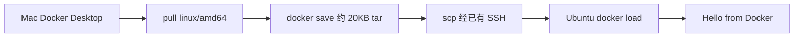

# 跨架构镜像：hello-world 已经在 Ubuntu 上跑起来

> **Verified / Completed**：Mac 上下载 `linux/amd64` 的 `hello-world`，经 `docker save`、SCP 和 `docker load` 传到 `xin-server`，并成功运行。
>
> 仍是计划、没有做成流程的部分：批量传输、在 Mac 上跨平台构建、给现有 Compose 项目加 `platform`。见文末。

返回 [项目首页](../README.md)。上一篇：[第一个网页](15-first-web-service.md)。

Mac 是 Apple Silicon，ARM64，装的是 Docker Desktop。`xin-server` 是 Ubuntu Server 26.04.1 LTS，x86_64，也就是 AMD64。Phase 2 最早的两张镜像是在服务器上用本机的静态 BusyBox 构建的，那两次没有跨架构。

后来这条传输链路单独做完了。官方 `hello-world` 的 AMD64 变体在 Mac 上下载，拷到 Ubuntu，打印出 `Hello from Docker!`。这和离线镜像那句 `Hello from Docker on xin-server!` 不是同一次运行。

## 平台是选出来的，不是翻译出来的

容器里跑的是 Linux 程序，不是 macOS 程序。镜像平台写成操作系统加架构，例如 `linux/arm64` 和 `linux/amd64`。

同一个标签背后常常是一份清单。清单里各有一张真正的镜像。Mac 的芯片是 ARM64，只说明这台机器自己执行程序时用 ARM64。它仍然可以向仓库要清单里的 `linux/amd64` 那一张。`--platform linux/amd64` 做的是这个选择。

它不会把 ARM64 二进制翻译成 AMD64。文件头里的机器类型还是下载时那一张的机器类型。选错张，Ubuntu 上就会出现 `exec format error`：内核看见的机器类型和当前 CPU 不符。那不是网络超时，也不是权限问题。这次没有碰到这个报错，因为保存前和加载后都核对了 `linux/amd64`。

Mac 上如果不加 `--platform`，客户端通常会拿 `linux/arm64`。把那张镜像加载到这台 AMD64 服务器上，就会走到上面的报错。加载之后还要再查一次，因为 `scp` 不改文件头，它只是把选错的文件原样送过去。

## 已经验证的流程

命令在 Mac 上执行。Docker Desktop 当时能够完成这次拉取。Mac 终端里不走代理的 curl，访问 Docker Registry 仍然会超时。拉取成功依靠的是 Docker Desktop 自己的网络路径，不是“Mac 上的任意程序都能直连 Docker Hub”。直连问题写在 [镜像仓库排查](11-docker-registry-troubleshooting.md)。

下载：

```bash
docker pull --platform linux/amd64 hello-world:latest
```

下载成功。核对的是 AMD64 那一层，而不是标签在 ARM Mac 上的默认层：

```bash
docker image inspect --platform linux/amd64 \
  hello-world:latest \
  --format '{{.Os}}/{{.Architecture}}'
```

结果是：

```text
linux/amd64
```

导出时带上同一个平台，避免 tar 里装进 ARM64 层。文件大约 20KB，是这次 hello-world 的体积，不是所有镜像的体积：

```bash
docker save --platform linux/amd64 \
  -o ~/Downloads/hello-world-amd64.tar \
  hello-world:latest
```

SCP 走已经配好的 `xin-server`。这条 SSH 在 Tailscale 上，地址不写进仓库：

```bash
scp ~/Downloads/hello-world-amd64.tar xin-server:/home/dev/
```

在服务器上导入。命令是在 `dev` 的 shell 里执行的，`~` 先展开成 `/home/dev`，读到的就是刚传上来的文件：

```bash
sudo docker load -i ~/hello-world-amd64.tar
```

输出：

```text
Loaded image: hello-world:latest
```

服务器上再查一次架构：

```bash
sudo docker image inspect hello-world:latest \
  --format '{{.Os}}/{{.Architecture}}'
```

结果仍是：

```text
linux/amd64
```

然后运行。`--pull=never` 让这次运行不再去联系 Docker Hub：

```bash
sudo docker run --rm --pull=never \
  --platform linux/amd64 hello-world:latest
```

成功输出：

```text
Hello from Docker!
```



tar 不进 Git。`.gitignore` 已经忽略 `*.tar`。

## 核对顺序

这次实际走通的顺序是：

1. 拉取时写明 `--platform linux/amd64`。
2. 保存前用带 `--platform` 的 `docker image inspect` 看 `Os` 和 `Architecture`。
3. `docker save` 也带 `--platform linux/amd64`。
4. `docker load` 之后在 Ubuntu 上再查一次。
5. 用 `--pull=never` 和 `--platform linux/amd64` 运行。

出现 `exec format error` 时，先回到第 2 步和第 4 步，而不是先怀疑守护进程。镜像 ID 比标签更接近“加载进来的到底是哪一层”。这次记录下来的结论是平台字符串 `linux/amd64`，没有把镜像 ID 抄进仓库。

## Compose 里的 platform 还没加到正在跑的项目上

以后的 Compose 文件可以声明：

```yaml
# Planned / Not Yet Tested — 不是 hello-web 正在使用的文件
services:
  app:
    image: <IMAGE>
    platform: linux/amd64
```

`platform` 约束的是拉取和构建。hello-web 那份 Compose 没有这个字段，因为它是在服务器上从本地文件构建的。这次传输测试没有回头改它。

在 ARM64 的 Mac 上构建、再拿到 AMD64 服务器运行，还要 Buildx 的跨平台构建。那次构建没有做。`docker buildx imagetools inspect` 也没有作为这次验证的一步执行。

## 还没做成流程的部分

下面这些保持 **Planned / Not Yet Tested**：

- 把 save、scp、load 收成可重复的脚本，或一次搬运多张镜像
- 在 Mac 上用 Buildx 构建 `linux/amd64` 再传过去
- 用 digest 固定镜像，而不是长期依赖 `latest`
- 给新的 Compose 项目写上 `platform: linux/amd64` 并实际部署

hello-world 这条链路已经完成。它不表示 Docker Hub 在 Ubuntu 上可以直连，也不表示每张需要的镜像都已经在服务器上。另外两条获取路径，包括不经过 Mac 的 AWS Public ECR，写在 [镜像获取策略](17-registry-access-strategy.md)。
