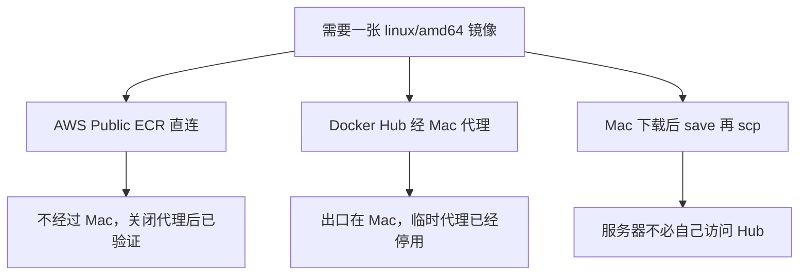
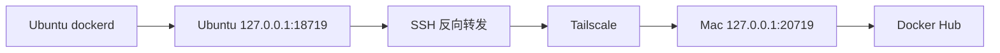

# 镜像获取策略

> Phase 2 后续验证。AWS Public ECR 可以在没有 Mac 代理的情况下独立拉取。
> Docker Hub 的直连仍然没有修好。GHCR 只验证了入口，没有拉取镜像。

返回 [项目首页](../README.md)。上一篇：[跨架构传输](16-cross-architecture-plan.md)。

## 当 Docker Hub 一直拒绝回应，我们为旧服务器找到了另一条路。

服务器需要的是一张 `linux/amd64` 镜像。Docker Hub 从 Ubuntu 直连，仍然超时，而且即使用 `--resolve` 指定地址，HTTPS 也还会被重置。具体是 DNS、出口、TLS 路径还是目标地址在变，没有足够证据写成一种已证实的机制。排查过程在 [镜像仓库排查](11-docker-registry-troubleshooting.md)。

在这个前提下，有三条已经试过的路。它们不是同一种成功。



## 1. AWS Public ECR：服务器自己拉取

这是目前唯一不依赖 Mac 代理的镜像下载。

临时代理先关掉：Docker 的 systemd drop-in 改成带 `.disabled` 后缀的文件名，执行 `systemctl daemon-reload`，再重启 Docker。之后的检查输出是：

```text
No Docker proxy configured
```

不经过代理访问入口：

```bash
curl -4 --noproxy '*' -I https://public.ecr.aws/v2/
```

返回 `HTTP/2 401`。对 Registry 的 `/v2/` 来说，401 是未登录时的正常认证响应，说明 HTTPS 已经到达服务，不是连接超时。

然后在 Ubuntu 上：

```bash
sudo docker pull --platform linux/amd64 \
  public.ecr.aws/docker/library/nginx:latest
```

所有层都下载完成，输出里有：

```text
Status: Downloaded newer image for public.ecr.aws/docker/library/nginx:latest
```

架构：

```bash
sudo docker image inspect \
  public.ecr.aws/docker/library/nginx:latest \
  --format '{{.Os}}/{{.Architecture}}'
```

```text
linux/amd64
```

运行：

```bash
sudo docker run --rm --pull=never \
  public.ecr.aws/docker/library/nginx:latest nginx -v
```

```text
nginx version: nginx/1.31.7
```

因此可以确定：这台 Ubuntu 能在没有 Mac 代理的情况下，从 AWS Public ECR 拉取、保存并执行 AMD64 的 Nginx 镜像。

限制同样具体：

- Docker Hub 直连还是不行。ECR 通了，不表示 `docker.io` 通了。
- Public ECR 没有 Docker Hub 上的全部镜像。换一个软件之前要先确认这里有它。
- 这次用的是 `latest`。长期运行的服务应该改成固定版本或 digest。这次验证没有做 digest 固定。
- 镜像来自公共仓库，拉取成功不等于已经完成生产加固。

## 2. Docker Hub 经 Mac 的 SSH 反向代理

这条路曾经成功拉取 `nginx:stable-alpine`，然后被关掉了。它不是现在的默认出网方式。

Mac 上的 Docker Desktop 能拉 AMD64 镜像，是因为它使用 macOS 的系统代理。系统代理监听在 Mac 的回环地址上。Mac 终端里直接 curl Registry 会超时。Docker Desktop 里看到的 `http.docker.internal:3128` 只在 Desktop 自己的环境里有意义，不能抄到 Ubuntu 上当代理地址。

在 Mac 上用系统代理显式访问 `https://registry-1.docker.io/v2/`，先得到代理隧道的 `HTTP/1.1 200 Connection established`，再得到 Registry 的 `HTTP/2 401`。401 仍是注册表在要求认证，不是拒绝这台机器的 TLS。

接着在 Mac 上打开一条反向转发。下面的端口是这次测试临时用的，不是一份给所有人的默认值：

```bash
ssh -N -T -o ExitOnForwardFailure=yes \
  -R 127.0.0.1:18719:127.0.0.1:20719 \
  xin-server
```

这条命令要留在 Mac 上。`-R` 让 Ubuntu 的 `127.0.0.1:18719` 转到 Mac 的 `127.0.0.1:20719`。`ExitOnForwardFailure=yes` 让端口绑不上时直接失败，而不是看起来连上了却没有转发。

Ubuntu 经这个本地端口访问 Registry，同样收到 HTTP 401。然后给 Docker 写过一份临时 drop-in，把 `HTTP_PROXY` 和 `HTTPS_PROXY` 指到 `http://127.0.0.1:18719`，执行 `daemon-reload` 并重启 Docker。重启之后，Ubuntu 上的这条命令成功了：

```bash
sudo docker pull --platform linux/amd64 nginx:stable-alpine
```

用拉下来的镜像起过测试容器，在 Ubuntu 的 `http://127.0.0.1:8081` 得到 HTTP 200。这是测试，不是 hello-web。hello-web 仍在 `127.0.0.1:8080`。



命令是在 Ubuntu 上执行的。镜像字节的出口仍是 Mac。Mac 关机、系统代理停掉，或者这条 SSH 退出，服务器就再次拉不到 Docker Hub。所以它只适合临时或备用。验证 ECR 之前，这份 drop-in 已经改名停用。

## 3. Mac 下载，再把文件传过去

Docker Desktop 在 Mac 上拉取 `linux/amd64`，`docker save` 打成 tar，SCP 到 `/home/dev/`，Ubuntu `docker load` 之后运行。`hello-world` 已经按这个顺序跑通，输出是 `Hello from Docker!`。

服务器在这一路里不访问 Docker Hub。Mac 要开着，并且 Docker Desktop 要能完成下载。步骤、平台核对和 `exec format error` 在 [跨架构传输](16-cross-architecture-plan.md)。

## 三条路怎么选

| 路径 | 已验证的结果 | Mac 是否必须在线 | 现在的状态 |
| --- | --- | --- | --- |
| AWS Public ECR | `nginx:latest` 拉取并执行，`nginx/1.31.7`，架构 `linux/amd64` | 拉取时不经过 Mac | 代理关闭后的独立路径 |
| Docker Hub 经 SSH 反向代理 | `nginx:stable-alpine` 拉取成功，本机 `127.0.0.1:8081` 返回 HTTP 200 | 需要 | 临时配置已停用 |
| save / scp / load | `hello-world:latest` 在 Ubuntu 上输出 `Hello from Docker!` | 传输时需要 | 单次验证完成，没有自动化 |

GitHub Container Registry 的入口也测过：

```bash
curl -4 --noproxy '*' -I https://ghcr.io/v2/
```

返回 `HTTP/2 405`。服务器有响应，但这次用的方法不是它接受的拉取方式。没有接着做一次真实的 `docker pull`。GHCR 不能写成已经可用的镜像源。

后续每个服务仍要单独确认镜像在哪个仓库、哪个平台、哪一个固定版本。PostgreSQL、Redis、自己的 API、备份和监控都还没开始。
