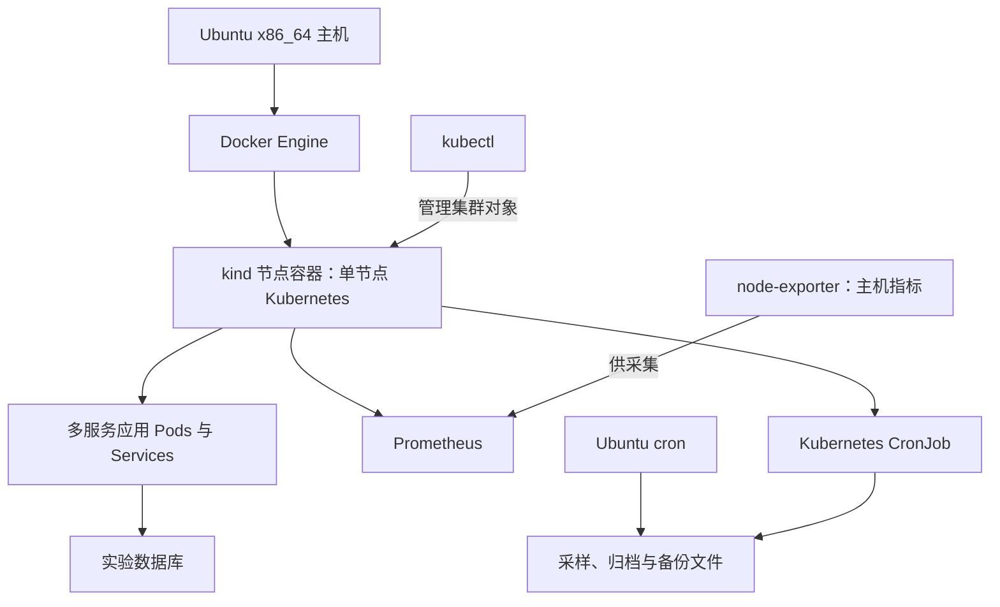

# Docker 之后：让服务器承载持续运行的工作负载

> Phase 3。整理日期：2026-10-28，按这次补充的操作经历回顾。
> 本次文档维护没有连接服务器重跑验证；未提供原始输出的版本、配额和调度参数保持待核实。

返回 [项目首页](../README.md)。上一篇：[镜像获取策略](17-registry-access-strategy.md)。

## 第一张网页之后，问题变了

Phase 2 结束时，我已经知道 Docker 能运行：本地构建的镜像打印过 Hello，Compose 交回过退出码 0，Mac 浏览器也打开过 hello-web。那时要解决的是“容器能不能启动”。后来服务器承载了一项科研实验，问题变成了“几个服务怎样一起跑下去”。

一个服务能启动，还得找到它依赖的另一个服务。数据库得接得住请求，进程退出以后得有人处理，运行过程还得留下可以回看的记录。只有一张网页时，这些问题不明显；多个组件一起运行之后，它们成了每天都要面对的事。

Compose 并不是因此失去用处。它已经完成了 Phase 2 的本地编排验证。这一阶段我需要接触的是 Kubernetes 的 Service、Pod、存储和 CronJob，所以在同一台 Ubuntu x86_64 服务器上部署了 kind 单节点集群，用 kubectl 管理。它是实验环境，没有变成多台机器组成的高可用集群。

科研项目在这里只作为服务器工作负载的背景。应用名称、评分方法、历史分数、原始数据、内部配置和完整工程目录都不属于这份公开日志。

## Docker、kind 和数据库，各自在做什么



图里的归档节点表示用途，没有声称 cron 和 CronJob 使用同一个挂载目录。具体路径、调度表达式和保留数量没有放进公开记录。

| 组件 | 在这台机器上的职责 |
| --- | --- |
| Docker Engine | 在 Ubuntu 上管理镜像和容器，承载 kind 的节点容器，也保留原来的容器使用方式 |
| kind / Kubernetes | 在节点容器里运行集群，管理 Pod、Service、存储挂载和定时任务。节点内部的容器运行时与主机 Docker 是不同的一层 |
| kubectl | 访问 Kubernetes API，读取状态、管理集群对象；它不是另一个容器引擎 |
| 数据库 | 保存应用状态、响应查询；Kubernetes 不替它完成数据一致性或备份 |
| node-exporter | 提供主机指标，供监控采集；它本身不是时序数据库 |
| Prometheus | 采集和查询指标，使用自己的 TSDB 保存时序数据；它不是业务数据库的备份工具 |

## 从“Pod 在跑”走到“请求真的通”

真实应用是通过容器部署的多个服务。我需要分别看镜像、服务发现、网络和存储，而不是只看一次 `kubectl get pods`。

Service 给应用提供访问入口，后面还得有对应的端点。数据库容器能启动，还得让依赖它的服务完成读请求。卷已经挂载，也不意味着删掉 Pod 后文件还会在。后来恢复 MongoDB 时，最后这一点直接决定了排障顺序。

下面是以后复查时可以用的只读命令，命名空间需要换成自己的值。它们是检查入口，不是这次执行过的逐行终端记录：

```bash
kubectl config current-context
kubectl get nodes
kubectl -n '<NAMESPACE>' get pods,svc,endpointslices
kubectl -n '<NAMESPACE>' get pvc
kubectl -n '<NAMESPACE>' get events --sort-by=.metadata.creationTimestamp
```

context 先看，是为了避免在错误的集群里排障。Pod 再看状态、重启次数和事件；Service 再看后端；存储再看实际使用的卷类型。`get pvc` 没有对象，并不能证明“没有数据”，因为 Pod 也可能使用 `emptyDir`。反过来，有 PVC 也不能直接证明备份已经做好。

这一阶段验证过多服务之间的访问、服务发现、网络、存储使用和数据库请求。公开仓库不附带业务请求样本，也不把这些局部验证扩大成所有故障条件下的可靠性保证。

## 16GB 内存开始成为实际约束

第一张静态网页可以用很小的内存限额。数据库和监控不能照搬它的配置。镜像能不能取得、是不是 `linux/amd64`、多个组件一起启动时有多少内存，开始同时影响部署。

实验中的 MySQL 5.7 曾经发生内存不足问题，后来改用 MariaDB 作为实验组件。这是应用环境里的一次选择调整，不是把整台 Ubuntu 的“系统数据库”升级成了 MariaDB。它也不意味着 MySQL 与 MariaDB 在每个版本、每种 SQL 和每个驱动上都可以直接互换。

具体的镜像标签、内存限额、退出状态，以及兼容性调整的逐项记录，本次没有原始输出可供复核，保持待核实。我能保留的经历是：数据库确实遇到过内存问题，实验组件后来做了调整。不能从这里反推后来的整机失联也是 OOM。

镜像方面仍沿用 Phase 2 学到的顺序：先确认可信来源和架构，再看拉取和启动。kind 节点里的镜像存储与主机 Docker 不是同一份；主机上有某张镜像，不代表 Pod 一定可以直接使用它。具体哪些镜像通过哪条路径进入集群，没有补写成一套已经验证的自动化流程。

## 监控开始留下连续的记录

Prometheus、node-exporter 等组件在实验环境中安装并运行后，我开始有机会回看主机和工作负载的变化。监控从此不只是登录服务器时执行一次 `free`。

新的问题是数据保存多久。Prometheus 的 TSDB retention 会影响还能查到多早以前的指标；采样一直在发生，不等于全部历史都还留着。当我要回看更早的运行状态时，保留窗口就成了实际限制。具体 retention 值和缺失时间范围仍待核实，这里不补一个看似精确的天数。

Prometheus 官方的 [存储说明](https://prometheus.io/docs/prometheus/latest/storage/) 区分了按时间和按大小的保留限制。我把它作为理解参数的参考，不把当前文档里的默认值冒充当时服务器的配置。指标保留、定时归档和数据库备份是三件事，不能互相代替。

## 定时采样、归档，再到备份

后来同时用了 Ubuntu cron 和 Kubernetes CronJob。前者由主机调度，后者由集群创建 Job。它们承担过定时采样、归档和备份任务。编辑器不必一直开着，任务的定义和执行环境都在服务器上。

但“存在任务定义”和“最近一次任务成功”还得分开看。复查时可以先读调度和执行记录：

```bash
# 在 Ubuntu 上只读检查，不编辑 crontab。
crontab -l
systemctl status cron --no-pager
kubectl -n '<NAMESPACE>' get cronjobs,jobs
```

`crontab -l` 只显示当前用户的条目；完整盘点还要考虑系统任务，不能凭这条命令宣布机器上所有调度都正常。输出里可能有私有路径和参数，不要原样贴进公开仓库。

数据文件还做过 SHA256 校验。下面只演示对一份**已经生成的归档**制作和复核校验文件，不包含采样脚本或研究数据：

```bash
# Ubuntu：先进入归档所在目录，再替换文件名。
sha256sum '<ARCHIVE_FILE>' > '<ARCHIVE_FILE>.sha256'
sha256sum -c '<ARCHIVE_FILE>.sha256'
```

传到 Mac 后，可以在同一目录用 `shasum -a 256 -c '<ARCHIVE_FILE>.sha256'` 复核。校验一致说明文件字节与清单一致，不证明数据库事务一致、数据齐全，也不替代恢复演练。

本机有归档，只能减少部分操作失误的损失。它仍和主机共用故障边界。后来把重要成果另存到 Mac，是额外留副本；完整的定期异机备份、告警和恢复演练还没有建成。

## 这一阶段到哪里为止

这台机器从“Docker 能跑”，走到了能够承载、监控和备份持续运行的实验工作负载。个人 PostgreSQL、Redis 和个人 API 的正式上线仍未完成；实验数据库不替它们打勾。

单节点集群没有消除主机故障。接下来发生的失联，让我必须回到本地显示器和键盘前，重新检查这些层能恢复到哪一步：[服务器失联、异常停机与恢复](19-server-outage-and-recovery.md)。
