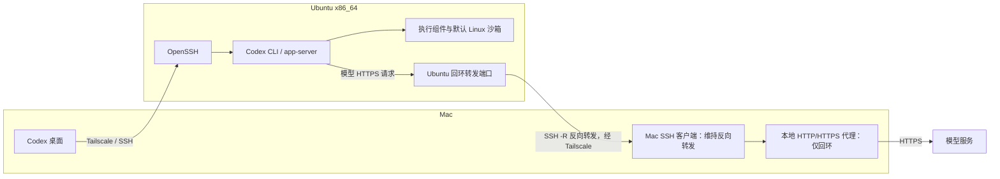

# 从安装 Codex，到默认沙箱里真的执行一条命令

> Phase 5，远程开发的 Codex 部分。整理日期：2026-10-28。
> 经历与版本来自本次补充的操作记录：Linux `codex-cli 0.165.0`，Ubuntu 仓库的 `bubblewrap 0.11.1` 当时验证过。本次维护未读取安装输出复核，发行版修订号、安装包来源细节和 Mac 应用版本待核实；这些不是长期指定版本。

返回 [项目首页](../README.md)。上一篇：[Cursor 远程开发](20-cursor-remote-development.md)。

## 安装好应用，只是第一步

我在 Mac 安装并登录 Codex 桌面应用时，服务器上的项目已经存在。目标是继续用 Mac 做控制端，让代码和命令留在 Ubuntu 执行。

Mac 上有应用，不等于 Ubuntu 上也有执行端。服务器是 Linux x86_64，需要对应架构的 Codex CLI，后面还涉及 app-server、执行组件和沙箱。排查到最后，我才把“能连接”拆成了五个不同的验收层次。

这篇保留当时走通的过程。安装入口和当前用法可以对照 OpenAI 的 [Codex CLI 文档](https://developers.openai.com/codex/cli/)。它们是参考资料，不能用来证明这台服务器某天的版本或连接状态。

## 两台机器的直接 HTTPS 都可能超时

Ubuntu 直接访问 OpenAI HTTPS 时超时。回到 Mac 终端直接 curl，也可能同样超时，但 macOS 已经配置了本地 HTTP/HTTPS 代理。终端里的 curl 不会因为系统设置里存在代理，就必然采用那条路径。

我在 Mac 上显式指定代理以后，curl 能建立 HTTPS 连接。这才把“代理可用”和“终端直接出网”分开。代理建立 CONNECT 隧道，也还要继续看后面的 TLS 和目标服务响应；它不是账号认证成功的证据。

下面是脱敏后的对照命令，不是要求读者照搬当时的临时端口。`--noproxy ''` 用来避免已有 NO_PROXY 规则跳过这次指定的代理：

```bash
# Mac：先替换端口。目标服务返回 HTTP 响应与账号是否获准访问是两件事。
curl --connect-timeout 10 --max-time 20 --noproxy '*' \
  -I https://api.openai.com/
curl --connect-timeout 10 --max-time 20 --noproxy '' \
  --proxy 'http://127.0.0.1:<MAC_PROXY_PORT>' \
  -I https://api.openai.com/
```

这里的目标地址只是 HTTPS 探测示例，不声称这一个域名覆盖了登录、模型请求所需的所有端点；也不把某个 HTTP 状态码写成固定的成功返回值。

## 把 Mac 的回环代理借给 Ubuntu

Ubuntu 的 `127.0.0.1` 是 Ubuntu 自己。把 Mac 的回环代理地址原样填过去，连不到 Mac。解决这一步的是从 Mac 发起 SSH `-R` 反向端口转发：

```bash
# Mac：保持这条连接，两个端口均需先替换。
ssh -N -T -o ExitOnForwardFailure=yes \
  -R '127.0.0.1:<SERVER_PROXY_PORT>:127.0.0.1:<MAC_PROXY_PORT>' \
  xin-server
```

Ubuntu 上的转发监听明确绑定回环地址；SSH 客户端再去连接 Mac 的回环代理。这是 OpenSSH [远程转发 `-R`](https://man.openbsd.org/ssh#R) 的方向，不是把 Mac 代理发布给整个校园网。还应在 Ubuntu 用 `ss -lnt` 核对实际监听，不能只看命令文字。

然后在 Ubuntu 显式经过转发端口做同样的 HTTPS 探测，并给当前 CLI 会话设置代理：

```bash
# Ubuntu：先替换端口，隧道和 Mac 代理需保持运行。
curl --connect-timeout 10 --max-time 20 --noproxy '' \
  --proxy 'http://127.0.0.1:<SERVER_PROXY_PORT>' \
  -I https://api.openai.com/

export HTTP_PROXY='http://127.0.0.1:<SERVER_PROXY_PORT>'
export HTTPS_PROXY="$HTTP_PROXY"
```

HTTPS 目标通过 HTTP CONNECT 代理时，代理 URL 使用 `http://` 并不把目标 TLS 改成明文。代理里没有账号密码示例，也没有使用 `curl -k` 跳过证书验证。

这些 export 只影响当前 shell 及其子进程。桌面经非交互 SSH 启动的 app-server 不一定继承它们。终端 curl 成功以后，还要核对真正发模型请求的进程使用了什么环境。永久环境注入方式没有完整记录，这里不虚构一份全局配置。

这条路径依赖 Mac 在线、代理在运行、SSH 隧道仍连接；它不是 Ubuntu 的独立出网能力。Phase 2 借代理拉镜像时曾修改并重启 Docker，那是另一段历史。Codex 的进程代理不需要照搬 Docker 的 systemd drop-in。

## 登录成功以后，先只验证模型

网络路径打通后，在 Ubuntu 核对版本，并使用设备授权登录。最后一条是以后复查登录状态的示例：

```bash
codex --version
codex login --device-auth
codex login status
```

当时验证过的版本输出是 `codex-cli 0.165.0`。设备授权在自己的浏览器里完成，登录的是 ChatGPT 账号。授权链接中的会话信息和一次性代码不进入文档，也不复制认证文件到仓库。

OpenAI 的 [认证说明](https://developers.openai.com/codex/auth) 介绍了无头环境的设备授权方式，也明确要求保护本地认证缓存。具体账号是否启用该方式应按自己的账号或工作区设置检查。

随后 CLI 的纯模型响应测试成功。那一步只要求返回文字，没有让它调用执行工具，所以只能说明当时模型请求通了。后面“模型能回复、工具不能用”的问题，正是这条验收边界的重要性。

## 桌面反复重连：先看非交互 PATH

Codex 桌面的远程 SSH 一度反复出现“正在重新连接”。普通终端已经能进入 Ubuntu，但桌面启动远程进程走的是另一种 shell 环境。

非交互 SSH 的 PATH 找不到 codex。排查可以先在 Mac 执行下面这条只读命令，不输出全部环境变量，以免暴露凭据：

```bash
ssh xin-server 'command -v codex; codex --version'
```

在交互终端里找到命令，不代表这条命令也找得到。当时通过 `/usr/local/bin/codex` 的符号链接，把已安装的入口放到非交互环境能找到的位置。若以后重做，要先核对目标是同一份 Linux x86_64 安装、目标可执行，而且没有覆盖现有入口；不要凭空猜一个安装目录。

```bash
# Ubuntu：只检查已有链接，不创建或覆盖文件。
ls -l /usr/local/bin/codex
readlink -f /usr/local/bin/codex
/usr/local/bin/codex --version
```

符号链接只修复命令发现，不替代网络、认证或执行组件检查。

## 旧 app-server 占着 control socket

PATH 之外，旧的 Codex app-server 进程还残留着，占用了 control socket。处理前先核对进程身份、属主和用途，确认是那一个旧的远程服务，再发送 SIGTERM，让它正常退出，之后重新连接。

这里不保留当时的 PID 或 socket 路径，也不给出按名字批量结束进程的命令。PID 会复用，其他会话也可能使用同类服务。旧服务占用的问题不能靠删除所有 socket 文件或一条强制 kill 当成固定修复方案。

## 主程序能启动，执行组件仍可能缺失

另一个问题更容易误判：单独提取 Codex 主程序后，模型仍能回复，执行工具却不可用。后来发现缺少 `codex-code-mode-host`，补齐组件后才继续往下走。

这说明 `codex --version` 不是安装完整性的全部验收。主程序、辅助执行组件及其相对布局都可能参与工作。不能因为两个可执行文件都叫 codex，就把来源或版本不同的组件拼在一起。那次补齐的详细安装路径本次未提供，后续应按可信发行包的完整结构核对。

## 默认沙箱失败，最后查到 bubblewrap

组件补齐以后，Linux 默认沙箱仍然启动失败。检查发现系统缺少 bubblewrap。后来从 Ubuntu 仓库安装了当时验证过的 `bubblewrap 0.11.1`，基础隔离测试通过。

复查软件包时可以先读版本和候选来源，而不是先改变系统策略：

```bash
apt-cache policy bubblewrap
bwrap --version
codex --help
```

基础 bubblewrap 测试通过，只说明那一层可工作。排查中还修正了沙箱测试命令，最后由 Codex 在默认沙箱中实际执行 `pwd` 和 `ls` 成功，才把执行链路记为打通。错误测试命令的全文本次未提供，不能编一条错误命令再把它当作现场证据。

这次没有关闭 AppArmor，也没有全局放开 user namespaces。OpenAI 的 [安全说明](https://developers.openai.com/codex/security) 可以用来理解隔离与批准的边界；本机缺少哪个组件、具体测试是否通过，仍以本机记录为依据。没有用关闭默认沙箱来替代修复。

## 最后连起来的是这几条路径



上面的 SSH 控制连接和反向转发各有用途。前者启动并连接远程执行端，后者把它发出的网络请求送到 Mac 代理。图里的地址和端口都没有固定成真实值。

## 五层验收，不能互相代替

| 层次 | 当时的验收 | 这一层不能替下一层证明什么 |
| --- | --- | --- |
| SSH 已连接 | Mac 能进入 Ubuntu，远程命令入口可找到 CLI | 不代表 ChatGPT 账号已登录 |
| 账号已登录 | 设备授权完成，CLI 登录状态正常 | 不代表模型请求一定有响应 |
| 模型已回复 | CLI 纯文字测试返回 | 不代表辅助执行组件齐全 |
| 工具能执行 | 补齐组件后，继续验证实际执行链路 | 不代表换成默认沙箱后也能执行 |
| 默认沙箱正常 | 最后在默认沙箱内执行 `pwd`、`ls` 成功 | 不代表每个工作目录、每种工具和长期运行场景都已验证 |

到这里，Mac 不只是能看见远程聊天回复，而是已经有一次默认沙箱内的实际命令执行结果。这是这段远程开发记录的完成点。代理断开后的重连、长期会话稳定性和主机故障后的完整恢复仍要单独验证，见 [Roadmap](../ROADMAP.md)。
